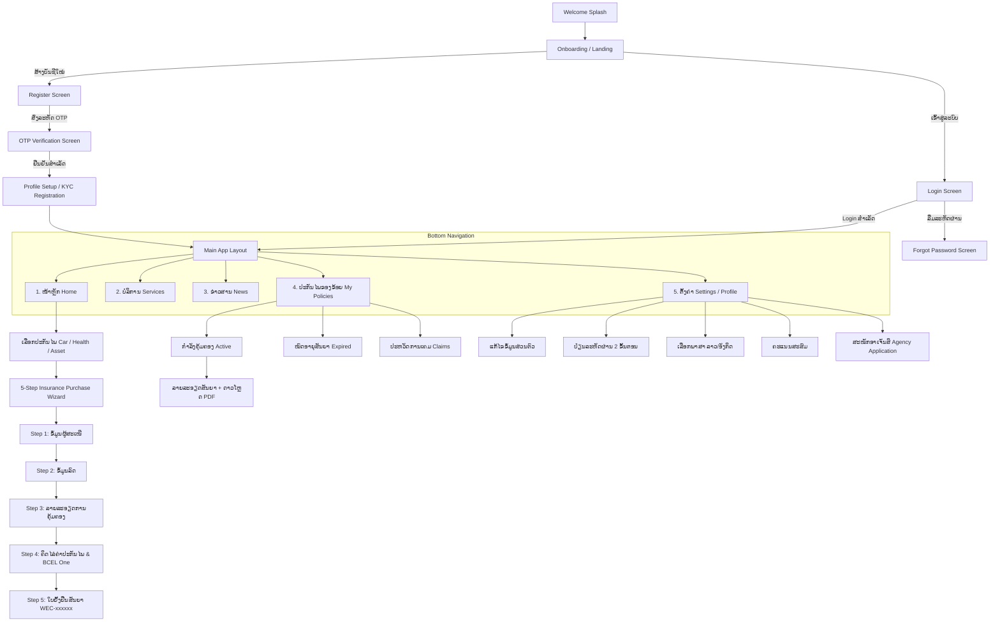

# SAIYFON INSURANCE DIGITAL - Mobile App UX/UI Design & System Specification
> **ເອກະສານສະຫຼຸບການອອກແບບ Layout, UX/UI ແລະ ຂໍ້ມູນທັງໝົດ ຈາກ `insurance app.pdf`**  
> ໂຄງການ: **SAIYFON INSURANCE DIGITAL (ສາຍຝົນ ນາຍໜ້າປະກັນໄພ)**  
> ເວີຊັນແອັບ: **v1.0.2**  
> ວັນທີສະຫຼຸບ: **2026-10-27**

---

## ສາລະບານ (Table of Contents)
1. [ພາບລວມຂອງລະບົບ ແລະ Identity (Project Identity)](#1-ພາບລວມຂອງລະບົບ-project-identity)
2. [ລະບົບການອອກແບບ ແລະ Design System (Color, Typography, Components)](#2-ລະບົບການອອກແບບ-design-system)
3. [ສະຖາປັດຕະຍະກຳຂໍ້ມູນ ແລະ Flow ການໃຊ້ງານ (Information Architecture)](#3-ສະຖາປັດຕະຍະກຳຂໍ້ມູນ-ແລະ-user-flows)
4. [ລາຍລະອຽດການອອກແບບແຕ່ລະໜ້າຈໍ (Screen-by-Screen UX/UI Specifications)](#4-ລາຍລະອຽດການອອກແບບແຕ່ລະໜ້າຈໍ)
   - [4.1 ກຸ່ມໜ້າ Onboarding & Authentication](#41-ກຸ່ມໜ້າ-onboarding--authentication)
   - [4.2 ໜ້າຫຼັກ (Home Dashboard)](#42-ໜ້າຫຼັກ-home-dashboard)
   - [4.3 ຂະບວນການເລືອກ ແລະ ຊື້ປະກັນໄພ (Insurance Purchase Flow - 5 Steps)](#43-ຂະບວນການເລືອກ-ແລະ-ຊື້ປະກັນໄພ-5-steps)
   - [4.4 ແຖບບໍລິການ (Services Tab)](#44-ແຖບບໍລິການ-services-tab)
   - [4.5 ແຖບຂ່າວສານ (News Tab & Details)](#45-ແຖບຂ່າວສານ-news-tab--details)
   - [4.6 ແຖບປະກັນໄພຂອງຂ້ອຍ (My Insurance / Policies Tab)](#46-ແຖບປະກັນໄພຂອງຂ້ອຍ-my-insurance--policies-tab)
   - [4.7 ແຖບໂປຣຟາຍ ແລະ ຕັ້ງຄ່າ (Profile & Settings Tab)](#47-ແຖບໂປຣຟາຍ-ແລະ-ຕັ້ງຄ່າ-profile--settings-tab)
   - [4.8 ລະບົບສະໝັກຕົວແທນ (Agency Application Flow)](#48-ລະບົບສະໝັກຕົວແທນ-agency-application-flow)
5. [ຂໍ້ມູນບໍລິສັດປະກັນໄພຄູ່ຮ່ວມ ແລະ ຜະລິດຕະພັນ (Insurance Partners & Products)](#5-ຂໍ້ມູນບໍລິສັດປະກັນໄພຄູ່ຮ່ວມ-ແລະ-ຜະລິດຕະພັນ)
6. [ຕາຕະລາງການຄຸ້ມຄອງ ແລະ ສູດຄິດໄລ່ເງິນ (Coverage Schedule & Calculation Formula)](#6-ຕາຕະລາງການຄຸ້ມຄອງ-ແລະ-ສູດຄິດໄລ່ເງິນ)
7. [ການເຊື່ອມຕໍ່ລະບົບພາຍນອກ (System Integrations & APIs)](#7-ການເຊື່ອມຕໍ່ລະບົບພາຍນອກ-integrations)

---

## 1. ພາບລວມຂອງລະບົບ (Project Identity)

- **ຊື່ລະບົບ:** SAIYFON INSURANCE DIGITAL
- **ເຈົ້າຂອງລະບົບ:** @Sayfon insurance broker (ບໍລິສັດ ສາຍຝົນ ນາຍໜ້າປະກັນໄພ)
- **ຄຳຂວັນ (Slogan / Tagline):** *"ເລື່ອງປະກັນໄພ ຄົບ ແລະ ຈົບຢູ່ບ່ອນດຽວ"*
- **ເປົ້າໝາຍຂອງແອັບ:** ເປັນ One-Stop Insurance Platform ເຕົ້າໂຮມບັນດາບໍລິສັດປະກັນໄພຊັ້ນນຳໃນ ສປປ ລາວ ໃຫ້ຜູ້ໃຊ້ສາມາດເລືອກ, ປຽບທຽບ, ຊື້ປະກັນໄພລົດ, ປະກັນໄພສຸຂະພາບ, ປະກັນໄພຊັບສິນ, ຊຳລະເງິນຜ່ານ BCEL One, ຈັດການສັນຍາປະກັນໄພ, ແລະ ສະໝັກເປັນຕົວແທນ (Agency) ໄດ້ງ່າຍດາຍໃນແອັບດຽວ.

---

## 2. ລະບົບການອອກແບບ (Design System)

### 2.1 Color Palette (ໂທນສີຫຼັກ)
- **Primary Green (ສີຂຽວຫຼັກ):** `#006838` ຫຼື `#0B6B3A` (ສີຂຽວແບຣນສາຍຝົນ, ໃຊ້ສຳລັບ AppBar, ປຸ່ມ Call To Action, ໄອຄອນ Active, Header)
- **Primary Dark Green:** `#044D29` (ກົດປຸ່ມ, Gradient ເທິງ)
- **Light Green Background Accent:** `#E8F5E9` ຫຼື `#F0FDF4` (ພື້ນຫຼັງໄອຄອນ, Tag active)
- **Secondary Slate/Navy:** `#2D3142` (ປຸ່ມຮອງ, ປຸ່ມ "ສ້າງບັນຊີໃໝ່", ປຸ່ມ "ສົ່ງອີກຄັ້ງ", ປຸ່ມ "+ ເພີ່ມຮູບໂປຣຟາຍ")
- **Discount / Alert Red:** `#D32F2F` / `#EF4444` (Badge ສ່ວນຫຼຸດ `-25%`, `-30%`, `-10%`, ໄຟສັນຍານສີແດງ)
- **Warning / Accent Amber:** `#F59E0B` (ໄຟສັນຍານສີເຫຼືອງ)
- **Success / Status Green:** `#10B981` (ເຄື່ອງໝາຍຖືກ, ໄຟສັນຍານສີຂຽວ)
- **Neutral Dark (Text):** `#1E293B` / `#000000` (ຫົວຂໍ້ ແລະ ຂໍ້ຄວາມຫຼັກ)
- **Neutral Muted (Text):** `#64748B` / `#94A3B8` (Placeholders, ລາຍລະອຽດຍ່ອຍ)
- **Surface / Card Background:** `#FFFFFF` (ສີພື້ນ Card ຂາວມົນ)
- **Border / Divider:** `#E2E8F0` / `#F1F5F9` (ເສັ້ນຂັ້ນ, Border ຊ່ອງ Input)

### 2.2 Typography & Iconography
- **ຟອນ:** ສະໜັບສະໜູນຟອນພາສາລາວມາດຕະຖານ (Noto Sans Lao, Saysettha OT) ແລະ ພາສາອັງກິດ (Inter / SF Pro Display)
- **Border Radius:**
  - ປຸ່ມກົດ (Buttons): `rounded-lg` (8px - 12px)
  - Card & Container: `rounded-xl` (12px - 16px)
  - Dropdown & Input fields: `rounded-md` ຫຼື `border-b` (Underline style)
- **ໄອຄອນ:** Line & Flat Icons, ມີ Status Bar ມາດຕະຖານ iOS (`9:41`, ສັນຍານ Wi-Fi, ແບັດເຕີຣີ)

### 2.3 Bottom Navigation Bar (ແຖບເມນູຫຼັກ 5 ປຸ່ມ)
ແອັບມີແຖບລຸ່ມຄົງທີ່ຕະຫຼອດການໃຊ້ງານໜ້າຫຼັກ:
1. **ໜ້າຫຼັກ (Home):** ໄອຄອນຮູບເຮືອນ 
2. **ບໍລິການ (Services):** ໄອຄອນມືຖືຫົວໃຈ/ຄົນ
3. **ຂ່າວສານ (News):** ໄອຄອນໂທລະໂຄ່ງ/ລຳໂພງ
4. **ປະກັນໄພຂອງຂ້ອຍ (My Insurance):** ໄອຄອນເອກະສານ/ໃບປະກັນໄພ
5. **ຕັ້ງຄ່າ (Settings):** ໄອຄອນຮູບເຟືອງ

---

## 3. ສະຖາປັດຕະຍະກຳຂໍ້ມູນ ແລະ User Flows

---

## 4. ລາຍລະອຽດການອອກແບບແຕ່ລະໜ້າຈໍ

### 4.1 ກຸ່ມໜ້າ Onboarding & Authentication

#### ໜ້າ 2: Welcome / Splash Screen (ຍິນດີຕ້ອນຮັບ)
- **Header:** Status bar 9:41
- **Center:**
  - ໂລໂກ້ຊ້າງ ສີຂຽວ-ຂາວ ພາຍໃນກອບຂອບມົນ
  - ຂໍ້ຄວາມຫົວຂໍ້ໃຫຍ່: **ຍິນດີຕ້ອນຮັບ!**
  - ຊື່ລະບົບ: **SAIYFON INSURANCE DIGITAL** (ຟອນ Serif / Bold)
- **Bottom:** ປຸ່ມ Outlined ສີຂຽວ: **"ເລີ່ມຕົ້ນ"**

#### ໜ້າ 3: Landing / Onboarding Intro
- **Center:**
  - ໂລໂກ້ຊ້າງ ສາຍຝົນປະກັນໄພ
  - ຄໍາຂວັນໃຫຍ່: **"ເລື່ອງປະກັນໄພ ຄົບ ແລະ ຈົບຢູ່ບ່ອນດຽວ"**
- **Bottom Actions:**
  - ປຸ່ມ Primary (ສີຂຽວເຕັມ): **"ເຂົ້າສູ່ລະບົບ"**
  - ປຸ່ມ Secondary (ສີຟ້າເຂັ້ມ/Slate): **"ສ້າງບັນຊີໃໝ່"**

#### ໜ້າ 4 & 5: Login Screen (ເຂົ້າສູ່ລະບົບ)
- **Top Navigation:** ປຸ່ມລູກສອນກັບຄືນ `<`
- **Title:** **"ເຂົ້າສູ່ລະບົບ"**
- **Form Fields:**
  - `Email` (ຕົວຢ່າງ: `banktsp9900.t@gmail.com`)
  - `Password` (ຕົວຢ່າງ: `••••••••••••`)
  - Link ຂວາ/ຊ້າຍສີຂຽວ: **"ລືມລະຫັດຜ່ານ?"**
- **Action:** ປຸ່ມໃຫຍ່ສີຂຽວ: **"ເຂົ້າສູ່ລະບົບ"**

#### ໜ້າ 6: Forgot Password (ລືມລະຫັດຜ່ານ)
- **Title:** **"ລືມລະຫັດຜ່ານ"**
- **Description:** *"ກະລຸນາ, ໃສ່ບັນຊີ Email. ທ່ານຈະໄດ້ຮັບລິ້ງເພື່ອສ້າງລະຫັດຜ່ານໃໝ່ຜ່ານທາງ email."*
- **Form Field:** `Email` ພ້ອມໄອຄອນລຶບ `✕`
- **Action:** ປຸ່ມໃຫຍ່ສີຂຽວ: **"ສົ່ງ"**

#### ໜ້າ 10 & 11: Register Screen (ສ້າງບັນຊີໃໝ່)
- **Title:** **"ສ້າງບັນຊີໃໝ່"**
- **Form Fields:**
  - `Email`: ປ້ອນອີເມວ (ຕົວຢ່າງ `banktsp9900.t@gmail.com`)
  - `Password`: ປ້ອນລະຫັດຜ່ານ ພ້ອມໄອຄອນຕາ (Show/Hide password)
  - `Phone number`: ເບີໂທລະສັບ ມີທຸງຊາດລາວ 🇱🇦 ແລະ ລະຫັດ `+856 20 77643515`
  - Checkbox: `☑ I agree to the Terms and Conditions`
- **Actions:**
  - ປຸ່ມສີຂຽວ: **"ລົງຊື່ເຂົ້າໃຊ້"**
  - Text link: *"ທ່ານມີບັນຊີແລ້ວ? **ເຂົ້າສູ່ລະບົບ**"*

#### ໜ້າ 12: OTP Verification (ກວດສອບບັນຊີຜ່ານ OTP)
- **Illustration:** ຮູບໂທລະສັບມືຖື ແລະ ຂໍ້ຄວາມ `OTP` ພ້ອມຄົນກຳລັງກວດສອບ
- **Title:** **"ກະລຸນາກວດສອບບັນຊີຂອງທ່ານ"**
- **Subtitle:** *"ພວກເຮົາໄດ້ສົ່ງລະຫັດການເຂົ້າເຖິງໃຫ້ທ່ານຜ່ານທາງ SMS ຫຼື ການຢືນຢັນເບີໂທລະສັບ"*
- **OTP Input:** ຊ່ອງກອກລະຫັດ 4 ຫຼັກ (ຕົວຢ່າງ `8 8 _ _`)
- **Action:**
  - ປຸ່ມ Primary (ສີຂຽວ): **"ຢືນຢັນ"**
  - ຂໍ້ຄວາມ: *"ລະຫັດໄດ້ຖືກສົ່ງໄປແລ້ວ?"*
  - ປຸ່ມ Secondary (ສີ Slate): **"ສົ່ງອີກຄັ້ງ"**

#### ໜ້າ 13: Account Verification Success
- **Illustration:** ຮູບໂທລະສັບມືຖື OTP
- **Title:** **"ຢືນຢັນການສ້າງບັນຊີ"**
- **Icon:** ປ້າຍວົງມົນສີຂຽວ ພ້ອມເຄື່ອງໝາຍຖືກ `✔`
- **Action:** ປຸ່ມສີຂຽວ: **"ຢືນຢັນ"**

#### ໜ້າ 14 & 15: Registration / Profile KYC Setup (ລົງທະບຽນຂໍ້ມູນຜູ້ໃຊ້)
- **Title:** **"ລົງທະບຽນ"**
- **Form Grid:**
  - `ຊື່ແທ້` (ຕົວຢ່າງ: `thadsaphone`) | `ນາມສະກຸນ` (ຕົວຢ່າງ: `chanjalern`)
  - `ວັນເດືອນປີເກີດ` (ຕົວຢ່າງ: `18/8/2001`) | `ທີ່ຢູ່ປະຈຸບັນ` (ຕົວຢ່າງ: `haiysok`)
  - `ໝາຍເລກ ID/Passport` (ຕົວຢ່າງ: `575158756`)
  - `ເພດ`: Dropdown ເລືອກ (`ຊາຍ` / `ຍິງ`)
  - `Email`: `banktsp9900.t@gmail.com`
  - `ອາຊີບ`: Dropdown/Text (ຕົວຢ່າງ: `student`)
- **Actions:**
  - ປຸ່ມສີ Slate: **"+ ເພີ່ມຮູບໂປຣຟາຍ"**
  - ປຸ່ມ Primary ສີຂຽວ: **"ສະໝັກ"**

---

### 4.2 ໜ້າຫຼັກ (Home Dashboard)
*(ເອກະສານໜ້າ 24 - 31, 63 - 64)*

- **Top Header:**
  - Background: Gradient ຂຽວອ່ອນ (Emerald) ພ້ອມລາຍໂລໂກ້ຊ້າງສາຍຝົນແບບ Watermark ໂປ່ງໃສ
  - ໂປຣຟາຍ Avatar (ຮູບຄົນສີຂຽວໃນວົງມົນ)
  - ໄອຄອນ Star Badge ດິຈິທັລ
- **Search Bar:**
  - Input ແບບ Pill ໂຄ້ງມົນ: `🔍 ຄົ້ນຫາປະກັນໄພຂອງທ່ານ`
- **Section 1: ບໍລິສັດປະກັນໄພ (Insurance Partner Grid & Carousel)**
  - ຫົວຂໍ້: **"ປະກັນໄພ"** ພ້ອມລິ້ງຂວາມື **"ເບິ່ງທັງໝົດ >"**
  - ສະແດງໂລໂກ້ບໍລິສັດປະກັນໄພ 6 - 16 ບໍລິສັດ:
    - ແຕ່ລະ Card ຈະມີ Badge ສ່ວນຫຼຸດພິເສດ ເຊັ່ນ: `-25%` (ທິບພະຍະ), `-30%` (ອາລິອັນສ໌), `-10%`
    - Pagination Dots ບອກສະຖານະ Slide (4 dots)
- **Section 2: ໂປຣໂມຊັ່ນພິເສດ (Promotions Carousel Banner)**
  - ຫົວຂໍ້: **"ໂປຣໂມຊັ່ນ"**
  - Banner 1: **"ຮັບຟຣີ! ຈອກໃສ່ກາເຟ ສຸດ Premium 1 ໜ່ວຍ ພຽງຊື້ ຫຼື ຕໍ່ສັນຍາປະກັນໄພໃໝ່"** (Allianz)
  - Banner 2: **"ອຸ່ນໃຈກັບ 'ປະກັນໄພຊັບສິນ ຮອບດ້ານ' ຄຸ້ມກັນທຸລະກິດ ແລະ ອຸດສາຫະກຳຂອງທ່ານຢ່າງຮອບດ້ານ"** (Allianz)
  - Banner 3: **"The Best PRODUCT FOR YOUR HOME 50% DISCOUNT 24/7"**
- **Fixed Bottom Navigation:** [ໜ້າຫຼັກ, ບໍລິການ, ຂ່າວສານ, ປະກັນໄພຂອງຂ້ອຍ, ຕັ້ງຄ່າ]

---

### 4.3 ຂະບວນການເລືອກ ແລະ ຊື້ປະກັນໄພ (5 Steps)

#### ຂັ້ນເລືອກປະເພດປະກັນໄພ (ໜ້າ 32 - 34)
1. **ເລືອກປະກັນໄພ (Select Insurance Category - ໜ້າ 32):**
   - 🚗 **ປະກັນໄພລົດ** (Vehicle Insurance)
   - 🏥 **ປະກັນໄພສຸຂະພາບ** (Health Insurance)
   - 🏠 **ປະກັນໄພຊັບສິນ** (Property / Asset Insurance)
2. **ເລືອກແບບປະກັນໄພ (Select Plan Type - ໜ້າ 33):**
   - ປະກັນຮັບຜິດຊອບຕໍ່ບຸກຄົນທີສາມ (Third-Party Liability)
   - ປະກັນຮັບຜິດຊອບຊັ້ນສອງ (Type 2)
   - ປະກັນຊັ້ນໜຶ່ງແບບ Package (Type 1 Package)
   - ປະກັນຊັ້ນໜຶ່ງແບບຮອບດ້ານ (Type 1 Comprehensive)
3. **ເລືອກປະເພດລົດ (Select Vehicle Type - ໜ້າ 34):**
   - ສະແດງເປັນ Grid Card 2 ຖັນ:
     - 🚗 **ລົດເກັງ** (Sedan) [Active Green]
     - 🛻 **ລົດກະບະ** (Pickup)
     - 🚙 **ລົດຈິບ** (SUV / Jeep)
     - 🚐 **ລົດຕູ້** (Van)
     - 🚛 **ລົດບັນທຸກ** (Truck)
     - 🚌 **ລົດເມ 10 ຫາ 45 ບ່ອນນັ່ງ** (Bus 10-45 Seats)

---

#### ຂັ້ນຕອນການຊື້ 5 ຂັ້ນຕອນ (5-Step Stepper Wizard)
ແອັບມີ **Stepper Header** ດ້ານເທິງ: `[1] — [2] — [3] — [4] — [5]` ພ້ອມໂລໂກ້ຊ້າງສາຍຝົນຢູ່ເຄິ່ງກາງ AppBar:

#### 🟢 Step 1: ຂໍ້ມູນຜູ້ສະເໜີເອົາປະກັນໄພ (ໜ້າ 51 - 53, 62)
- **Title:** `ຂໍ້ມູນຜູ້ສະເໜີເອົາປະກັນໄພ`
- **Fields:**
  - `ຊື່ ແລະ ນາມສະກຸນ`: Text Input (Placeholder: `--ຊື່ ແລະ ນາມສະກຸນ--`)
  - `ເບີໂທລະສັບ`: Text Input (Placeholder: `020 xxxxx`, Value: `205861862`)
  - `ທີ່ຢູ່`: Text Input (Value: `haiysok`)
  - `ວັນ/ເດືອນ/ປີ ເກີດ`: Date Picker (Placeholder: `ວວ/ດດ/ປປ`, Value: `18/12/2001`)
  - `ເພດ`: Dropdown (`ຊາຍ` / `ຍິງ`)
  - `ປະເພດເອກະສານຢັ້ງຢືນ`: Dropdown (`ບັດປະຈຳໂຕ` / `Passport`)
  - `ເລກທີ່ບັດປະຈຳໂຕ/Passport`: Text Input (Value: `855265`)
  - ປຸ່ມ Upload: **"ອັບໂຫຼດບັດປະຈຳໂຕ"** (Button Slate)
- **Footer Actions:** ປຸ່ມຂຽວ: **"ໄປຕໍ່"**

#### 🟢 Step 2: ຂໍ້ມູນລົດທີ່ຊື້ປະກັນໄພ (ໜ້າ 54)
- **Title:** `ຂໍ້ມູນລົດທີ່ຊື້ປະກັນໄພ`
- **Fields:**
  - `ການນຳໃຊ້`: Dropdown (Placeholder: `--ກະລຸນາເລືອກ--`)
  - `ປະເພດລົດ`: Dropdown (Placeholder: `--ກະລຸນາເລືອກ--`)
  - `ຍີ່ຫໍ້`: Text Input (Placeholder: `HONDA, BMW`)
  - `ລຸ້ນ`: Text Input
  - `ທະບຽນລົດ`: Text Input (Placeholder: `xx 9998`)
  - `ເລກຈັກ`: Text Input
  - `ເລກຖັງ`: Text Input (Placeholder: `--ກະລຸນາປ້ອນເລກຖັງ--`)
  - `ຄວາມແຮງ / ບ່ອນນັ່ງ / ນ້ຳໜັກບັນທຸກ`: Dropdown
  - ປຸ່ມ Upload: **"ອັບໂຫຼດ ທະບຽນລົດ"**
- **Footer Actions:** ປຸ່ມຂາວ **"ກັບຄືນ"** | ປຸ່ມຂຽວ **"ໄປຕໍ່"**

#### 🟢 Step 3: ລາຍລະອຽດການຄຸ້ມຄອງ (ໜ້າ 55 - 56)
- **Title:** `ລາຍລະອຽດການຄຸ້ມຄອງ`
- **Policy Dates:**
  - `ວັນທີເລີ່ມຄຸ້ມຄອງ`: Read-only / DateTime (ຕົວຢ່າງ: `20/10/2022 14:02:00`)
  - `ວັນສິ້ນສຸດການຄຸ້ມຄອງ`: Read-only / DateTime (ຕົວຢ່າງ: `19/10/2023 23:59:00`)
- **Plan Selection:** `ແຜນຄຸ້ມຄອງບຸກຄົນທີສາມ` (Dropdown: `ລາຄາພາກບັງຄັບ`)
- **Coverage Details Table (ຕາຕະລາງການຄຸ້ມຄອງເພີ່ມເຕີມ):**
  | ລາຍລະອຽດການຄຸ້ມຄອງ | ວົງເງິນສູງສຸດ |
  |---|---|
  | **1. ຄວາມຮັບຜິດຊອບທາງແພ່ງຕໍ່ບຸກຄົນທີສາມ** | |
  | - ຄວາມເສຍຫາຍດ້ານຮ່າງກາຍສູງສຸດ/ອຸບັດຕິເຫດ | 101,400,000 kip |
  | - ເສຍຊີວິດ / ພິການຖາວອນ, ສູງສຸດຕໍ່ຄົນ | 12,000,000 kip |
  | - ຄ່າປິ່ນປົວ, ສູງສຸດ / ຄົນ | 1,800,000 kip |
  | - ຄ່າອອກໂຮງໝໍ | 100,000 kip |
  | - ຄວາມເສຍຫາຍດ້ານວັດຖຸ, ສູງສຸດ / ຄົນ | 5,200,000 kip |
  | **2. ຜູ້ຂັບຂີ່** | |
  | - ເສຍຊີວິດ / ພິການຖາວອນ, ສູງສຸດ | 30,000,000 kip |
  | - ຄ່າປິ່ນປົວ, ສູງສຸດ | 3,000,000 kip |
  | **3. ຄ້ຳປະກັນການປົກປ້ອງສິດ ສູງສຸດ/ອຸບັດຕິເຫດ** | 150,000 kip |
  | **4. ຄວາມເສຍຫາຍຕໍ່ຕົວລົດທີ່ເອົາປະກັນໄພ** | 0 kip |
  | **5. ການເສຍຊີວິດຂອງຄົນໃນຄອບຄົວ** | 0 kip |
  | **6. ຄ່າປິ່ນປົວຄົນໃນຄອບຄົວ** | 0 kip |
- **Link ເພີ່ມເຕີມ:** `ອ່ານຂໍ້ມູນເພີ່ມເຕີມ >` (ສະແດງນິຍາມເງື່ອນໄຂ, ສາຍດ່ວນ 021 633 222, 030 5054 234)
- **Footer Actions:** ປຸ່ມ **"ກັບຄືນ"** | ປຸ່ມ **"ໄປຕໍ່"**

#### 🟢 Step 4: ລາຍລະອຽດຄ່າປະກັນໄພ ແລະ ຊຳລະເງິນ (ໜ້າ 57)
- **Title:** `ລາຍລະອຽດຄ່າປະກັນໄພ`
- **Invoice Breakdown Card:**
  | ລາຍການ (Item) | ຈຳນວນເງິນ (Amount) |
  |---|---|
  | ຄ່າປະກັນໄພພື້ນຖານ | 1,945,455 LAK |
  | ສ່ວນຫຼຸດ (Discount) | 30% |
  | ຄ່າປະກັນໄພຫຼັງຫຼຸດ | 1,361,818 LAK |
  | ຄ່າປະກັນໄພເພີ່ມເຕີມ | 0 LAK |
  | ອາກອນມູນຄ່າເພີ່ມ (7% VAT) | 95,327 LAK |
  | ຄ່າຂຶ້ນທະບຽນ | 20,000 LAK |
  | **ຄ່າປະກັນໄພລວມ (Total)** | **1,477,146 LAK** |
- **Payment Method Integration:**
  - ໂລໂກ້ **BCEL One**
- **Action Button:** ປຸ່ມສີຂຽວໃຫຍ່: **"ກົດຊຳລະຄ່າປະກັນໄພ"**

#### 🟢 Step 5: ໃບຢັ້ງຢືນສັນຍາປະກັນໄພລົດ (ໜ້າ 58)
- **Title:** `ໃບຢັ້ງຢືນສັນຍາປະກັນໄພລົດ`
- **Policy Summary Card:**
  - ເລກທີສັນຍາ: `ໃບຢັ້ງຢືນສັນຍາປະກັນໄພລົດ WEC-176482`
  - ວັນທີເລີ່ມຄຸ້ມຄອງ: `20/10/2022 14:02:00`
  - ວັນສິ້ນສຸດການຄຸ້ມຄອງ: `19/10/2023 23:59:00`
- **ລາຍລະອຽດຜູ້ສະເໜີເຂົ້າປະກັນໄພ:**
  - ຊື່ຜູ້ໄດ້ຮັບປະກັນໄພ: `Thadsaphone`
  - ເບີໂທລະສັບ: `+856 204766167`
  - ວັນ/ເດືອນ/ປີ ເກີດ: `19/2/2001`
  - ທີ່ຢູ່: `Vientiane Capital`
  - ປະເພດເອກະສານຢັ້ງຢືນ: `Passport`
  - ເລກທີ: `4578617637`
- **ລາຍລະອຽດຂອງຍານພາຫະນະ:**
  - ປະເພດລົດ: `ລົດຄຸ້ມເຄື່ອງ`
- **Action Button:** ປຸ່ມສີຂຽວ: **"ຢືນຢັນ"**

---

### 4.4 ແຖບບໍລິການ (Services Tab)
*(ເອກະສານໜ້າ 36, 37, 50)*

- **Top Bar:** ສີຂຽວ ພ້ອມຫົວຂໍ້: **"ການບໍລິການ"**
- **Service Promotion Cards:**
  1. **Allianz:** "ອຸ່ນໃຈກັບ ປະກັນໄພຊັບສິນ ຮອບດ້ານ (ຄຸ້ມກັນທຸລະກິດ ແລະ ອຸດສາຫະກຳ)"
  2. **FORTE TOKO:** "ເດີນທາງແບບສະບາຍໃຈ ກັບປະກັນໄພ ຍານພາຫະນະ"
  3. **FigTree Blue:** "ເມື່ອທ່ານນຶກເຖິງ ປະກັນໄພສຸຂະພາບລະຫວ່າງປະເທດ (ເລີ່ມຕົ້ນ 0.55$ / ມື້, ຄຸ້ມກັນ 30,000$)"

---

### 4.5 ແຖບຂ່າວສານ (News Tab & Details)
*(ເອກະສານໜ້າ 38, 39)*

- **News Feed Screen (ໜ້າ 38):**
  - Header ສີຂຽວ: **"ຂ່າວສານໃໝ່ໆ"**
  - ລາຍການຂ່າວ (News Cards): ຮູບພາບ Thumbnail + ຫົວຂໍ້ຂ່າວ + ເນື້ອໃນຫຍໍ້ + ວັນທີເວລາ (`11/10/2022 10:30`)
    - ຂ່າວ 1: *"ປະກັນໄພທີ່ຢູ່ອາໄສ ໃຫ້ທ່ານອຸ່ນໃຈ ແລະ ໝັ້ນໃຈ ຖ້າມີຄວາມເສຍຫາຍເກີດຂຶ້ນກັບຊັບສິນ..."*
    - ຂ່າວ 2: *"ປະກັນຊີວິດແບບອຸ່ນໃຈ-ຫາຍຫ່ວງ Life Protection Insurance ຄຸ້ມຄອງສູງສຸດ 500 ລ້ານກີບ..."*
    - ຂ່າວ 3: *"ທີມງານອາລິອັນສ໌ຂໍເປັນສ່ວນຮ່ວມຕ້ອນຮັບທີມນັກກິລາແລ່ນ 385 ກິໂລແມັດ 'ແລ່ນເພື່ອເດັກນ້ອຍ'..."*

- **News Detail Screen (ໜ້າ 39):**
  - Header: ປຸ່ມກັບຄືນ `<` | **"ລາຍລະອຽດ"**
  - Hero Image: ຮູບພາບຄອບຄົວ/ບ້ານ
  - ຫົວຂໍ້ໃຫຍ່: **Home Insurance ໃຫ້ທ່ານອຸ່ນໃຈ ແລະ ໝັ້ນໃຈ ຈາກອັກຄີໄພ ແລະ ໄພອື່ນໆ**
  - ລາຍການຄຸ້ມກັນ:
    - ✔ ອັກຄີໄພ
    - ✔ ຄວາມເສຍຫາຍຍ້ອນນ້ຳ-ລົມພາຍຸ
    - ✔ ແກ້ວແວ່ນແຕກ
    - ✔ ຄວາມເສຍຫາຍຂອງເຄື່ອງໃຊ້ໄຟຟ້າ
    - ✔ ເຄື່ອງໃນອາຄານຖືກລັກ
    - ✔ ຄວາມຮັບຜິດຊອບຕໍ່ກັບເຮືອນຂ້າງຄຽງ
    - ✔ ຄວາມຮັບຜິດຊອບຂອງຫົວໜ້າຄອບຄົວ
  - Footer Disclaimer ຂອງ Allianz
  - Hashtags: `#MyInsuranceApp #AllianzLaos #HomeInsurance`

---

### 4.6 ແຖບປະກັນໄພຂອງຂ້ອຍ (My Insurance / Policies Tab)
*(ເອກະສານໜ້າ 40 - 44, 59)*

- **Header:** **"ປະກັນໄພຂອງຂ້ອຍ"**
- **Sub-Tabs (ແຖບສະຖານະ 3 ແຖບ):**
  1. **ກຳລັງຄຸ້ມຄອງ (Active Policies):** ສະແດງບັດສັນຍາທີ່ກຳລັງເຮັດວຽກ ເຊັ່ນ: `ປະກັນໄພລົດກະບະ`, `ປະກັນໄພລົດຈິບ`
  2. **ໝົດອາຍຸສັນຍາ (Expired Policies):** ສະແດງບັດສັນຍາທີ່ໝົດອາຍຸ
  3. **ປະຫວັດການເຄມ (Claims History):** ລາຍການປະຫວັດການແຈ້ງເຄມປະກັນໄພ
- **Policy Contract Detail / Ticket Screen (ໜ້າ 44 & 59):**
  - Card ແບບ Ticket / ໃບບິນ ຕັດຂອບປະ
  - ປະເພດ: 🚗 `ປະກັນໄພລົດ`
  - ຂໍ້ມູນຜູ້ຊື້: `thadsaphone` | ວັນເດືອນປີເກີດ `18/8/2001`
  - ຍອດຊຳລະຄ່າປະກັນໄພ: `1.400.000 LAK`
  - ວັນທີເລີ່ມຄຸ້ມຄອງ: `20/10/2022` | ວັນທີສິ້ນສຸດ: `19/10/2023`
  - ຊຳລະຜ່ານທາງ: ໂລໂກ້ **BCEL One**
  - Action Button: ປຸ່ມສີຂຽວ **"ຂໍ້ມູນສັນຍາ PDF"** (ດາວໂຫຼດ/ເບິ່ງໄຟລ໌ສັນຍາ)

---

### 4.7 ແຖບໂປຣຟາຍ ແລະ ຕັ້ງຄ່າ (Profile & Settings Tab)
*(ເອກະສານໜ້າ 17 - 23, 45 - 49)*

- **Profile Header:**
  - ພື້ນຫຼັງສີຂຽວມົນ
  - ຮູບ Profile Avatar ຂະໜາດໃຫຍ່
  - ຊື່: **Thadsaphone CHANJALERN**
  - ເບີໂທ: `+856 207788445`
  - ປຸ່ມ Quick Action ເທິງຂວາ: `ແກ້ໄຂຂໍ້ມູນ` (ໄອຄອນສໍ)
  - ປຸ່ມໃຫຍ່ກາງ: **"ສະໝັກອາເຈັນສິ"** (Apply to become an Agent)
- **Menu Items List:**
  1. ✏ **ແປງຂໍ້ມູນ / ແກ້ໄຂຂໍ້ມູນ** (Edit Profile) -> ເປີດໜ້າແກ້ໄຂຂໍ້ມູນສ່ວນຕົວ
  2. 🌐 **ພາສາ / ປ່ຽນພາສາ** (Language) -> ເປີດໜ້າເລືອກພາສາ
  3. 🪙 **ຄະແນນສະສົມ** (Reward Points) -> ສະແດງໜ້າຄະແນນສະສົມ
  4. 🔒 **ປ່ຽນລະຫັດຜ່ານ** (Change Password) -> ຂະບວນການ 2 ຂັ້ນຕອນ
  5. 📄 **ເງື່ອນໄຂ ແລະ ຂໍ້ກຳນົດ** (Terms & Conditions)
  6. 👥 **ກ່ຽວກັບພວກເຮົາ** (About Us)
  7. 🚪 **ອອກຈາກລະບົບ** (Logout)
- **Footer Text:**
  - `@Sayfon insurance broker`
  - `Version: 1.0.2`

#### ໜ້າແກ້ໄຂຂໍ້ມູນສ່ວນຕົວ (ໜ້າ 49)
- **Header:** ແຖບສີຂຽວ, ປຸ່ມ `✕`, **"ແກ້ໄຂຂໍ້ມູນສ່ວນຕົວ"**
- **Avatar Editor:** ປຸ່ມ **"ອັບໂຫຼດຮູບພາບ"**
- **Editable Row Items (ພ້ອມໄອຄອນ Edit):**
  - ຊື່ແທ້: `Thadsaphone`
  - ນາມສະກຸນ: `CHANJALERN`
  - ເບີໂທລະສັບ: `201647899`
  - ເພດ: `ຊາຍ`

#### ໜ້າປ່ຽນລະຫັດຜ່ານ (ໜ້າ 17 - 18)
- **ຂັ້ນຕອນທີ 1:** ປ້ອນລະຫັດຜ່ານເກົ່າ -> ປຸ່ມ **"ໄປຕໍ່"**
- **ຂັ້ນຕອນທີ 2:** 
  - ປ້ອນລະຫັດຜ່ານໃໝ່
  - ຢືນຢັນລະຫັດຜ່ານ
  - ໝາຍເຫດແນະນຳ:
    - ຕ້ອງມີຕົວອັກສອນໃຫຍ່ ແລະ ນ້ອຍ
    - ຕ້ອງມີຕົວເລກຢ່າງໜ້ອຍໜຶ່ງໂຕຂຶ້ນໄປ
    - ຕ້ອງມີລະຫັດ 8 ໂຕຂຶ້ນໄປ
  - ປຸ່ມ: **"ຕົກລົງ"**

#### ໜ້າເລືອກພາສາ (ໜ້າ 20)
- **Header:** **"ເລືອກພາສາ"** ພ້ອມປຸ່ມ **"ຕົກລົງ"** ເທິງຂວາ
- **Radio List:**
  - ⭕ ພາສາລາວ (ພ້ອມທຸງຊາດລາວ 🇱🇦)
  - ⭕ ພາສາອັງກິດ (ພ້ອມທຸງອັງກິດ/UK 🇬🇧)

---

### 4.8 ລະບົບສະໝັກຕົວແທນ (Agency Application Flow)
*(ເອກະສານໜ້າ 60, 61)*

- **ຈຸດປະສົງ:** ໃຫ້ຜູ້ໃຊ້ສາມາດສະໝັກເຂົ້າຮ່ວມເປັນຕົວແທນຂາຍປະກັນໄພ (Insurance Agent) ຂອງສາຍຝົນ
- **ໜ້າເງື່ອນໄຂການສະໝັກ (ໜ້າ 60):**
  - ຫົວຂໍ້: **ສາຍຝົນປະກັນພັນ**
  - **ຂໍ້ກຳນົດການສະໝັກເປັນອາເຈັນສິ** (ອັບເດດຫຼ້າສຸດ: ໃນວັນທີ 2 / 8 / 2023)
  - Bullet points ຂໍ້ກຳນົດ ແລະ ຄຸນສົມບັດຂອງຕົວແທນ
  - ປຸ່ມ: **"ຕົກລົງ"**
- **ໜ້າແບບຟອມສະໝັກ (ໜ້າ 61):**
  - ຫົວຂໍ້: **"ແບບຟອມສະໝັກ"**

---

## 5. ຂໍ້ມູນບໍລິສັດປະກັນໄພຄູ່ຮ່ວມ ແລະ ຜະລິດຕະພັນ

### 5.1 ລາຍຊື່ 17 ບໍລິສັດປະກັນໄພຄູ່ຮ່ວມ (Insurers Directory)
1. **ທິບພະຍະປະກັນໄພ (Dhipaya Insurance)** - ມີໂປຣໂມຊັ່ນສ່ວນຫຼຸດ 25% / 10%
2. **ລ້ານຊ້າງປະກັນໄພ (Lanexang Insurance)**
3. **ພົງສະຫວັນປະກັນໄພ (Phongsavanh Insurance - APA)**
4. **ຟໍເຕ-ໂຕໂກປະກັນໄພ (Forte Toko Assurance)**
5. **ອາລິອັນສ໌ປະກັນໄພລາວ (Allianz General & Life Insurance)** - ມີສ່ວນຫຼຸດ 30%
6. **ລາວ-ຫວຽດປະກັນໄພ (Lao-Viet Insurance - LVI)**
7. **ໂຊກໄຊປະກັນໄພ (Sokxay Insurance)**
8. **ວຽງຈັນປະກັນໄພ (Vientiane Insurance)**
9. **ເອັສທີ-ເມືອງໄທປະກັນໄພ (ST-Muang Thai Insurance)**
10. **ລາວວິວັດປະກັນໄພ (Lao Vivat Insurance)**
11. **ຈົງຈິງປະກັນໄພ (Zhongji Insurance)**
12. **ລາວເທບຈະເລີນ (Laothepchalern Insurance)**
13. **ກຸງເທບປະກັນໄພ (Bangkok Insurance)**
14. **ທີເຄໄອປະກັນໄພ (TKI Life & General Insurance)**
15. **ບີເອັສເຮັສປະກັນໄພ (BSH Insurance)**
16. **ສາກົນປະກັນໄພ (GIC Insurance)**
17. **ລາວຈີນປາຊີຟິກ (Lao-China Pacific Insurance)**

---

## 6. ຕາຕະລາງການຄຸ້ມຄອງ ແລະ ສູດຄິດໄລ່ເງິນ

### 6.1 ສູດຄິດໄລ່ຄ່າປະກັນໄພລວມ (Step 4 Formula)
$$\text{ຄ່າປະກັນໄພຫຼັງຫຼຸດ} = \text{ຄ່າປະກັນໄພພື້ນຖານ} - (\text{ຄ່າປະກັນໄພພື້ນຖານ} \times \% \text{ສ່ວນຫຼຸດ})$$
$$\text{ອາກອນມູນຄ່າເພີ່ມ (VAT 7\%)} = \text{ຄ່າປະກັນໄພຫຼັງຫຼຸດ} \times 7\%$$
$$\text{ຍອດລວມທັງໝົດ} = \text{ຄ່າປະກັນໄພຫຼັງຫຼຸດ} + \text{ຄ່າປະກັນເພີ່ມເຕີມ} + \text{VAT (7\%)} + \text{ຄ່າຂຶ້ນທະບຽນ}$$

**ຕົວຢ່າງການຄຳນວນຕົວຈິງໃນແອັບ:**
- ຄ່າປະກັນໄພພື້ນຖານ: `1,945,455 LAK`
- ສ່ວນຫຼຸດ (30%): `- 583,637 LAK`
- ຄ່າປະກັນໄພຫຼັງຫຼຸດ: `1,361,818 LAK`
- ຄ່າປະກັນເພີ່ມເຕີມ: `0 LAK`
- ອາກອນມູນຄ່າເພີ່ມ 7%: `95,327 LAK`
- ຄ່າຂຶ້ນທະບຽນ: `20,000 LAK`
- **ລວມຍອດທີ່ຕ້ອງຊຳລະ:** `1,477,145 LAK` (ສະແດງ `1,477,146 LAK`)

---

## 7. ການເຊື່ອມຕໍ່ລະບົບພາຍນອກ (Integrations)

1. **Payment Gateway: BCEL One Integration**
   - ຮອງຮັບການຊຳລະເງິນທັນທີຜ່ານແອັບ BCEL One (Deeplink ຫຼື QR Code PromptPay/LaoQR)
2. **SMS Gateway / OTP Service**
   - ສົ່ງລະຫັດ OTP 4 ຕົວເລກ ເພື່ອຢືນຢັນເບີໂທລະສັບຕອນສະໝັກສະມາຊິກ
3. **File & Image Upload Service**
   - ຮອງຮັບການຖ່າຍຮູບ / ອັບໂຫຼດ:
     - ຮູບໂປຣຟາຍຜູ້ໃຊ້
     - ບັດປະຈຳໂຕ ຫຼື Passport
     - ປຶ້ມທະບຽນລົດ (Yellow Book / Blue Book)
4. **PDF Engine / Policy Generator**
   - ອອກເລກທີສັນຍາ (ເຊັ່ນ `WEC-176482`) ແລະ ສ້າງໄຟລ໌ສັນຍາ PDF ເພື່ອໃຫ້ຜູ້ໃຊ້ກົດດາວໂຫຼດ `ຂໍ້ມູນສັນຍາ PDF`

---
*ເອກະສານນີ້ຖືກສະຫຼຸບ ແລະ ຖອດລະຫັດຈາກຮູບແບບ Wireframe, Mockup, ແລະ UI Design ຕົວຈິງທັງໝົດ 64 ໜ້າ ໃນ `insurance app.pdf` ຢ່າງຄົບຖ້ວນ.*
