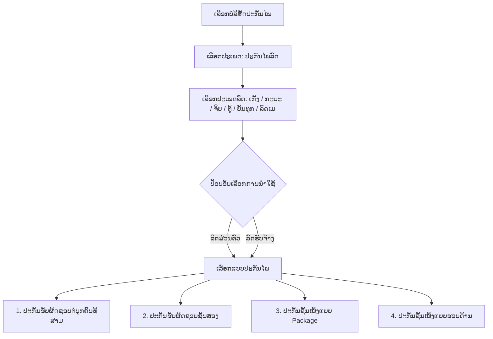

# ແຜນການຂາຍປະກັນໄພອອນລາຍຫຼັງບ້ານ ແລະ ແອັບມືຖື (SAIYFON INSURANCE DIGITAL)
> **ເອກະສານສະຫຼຸບຂໍ້ມູນ ແລະ ໂຄງສ້າງລະບົບທັງໝົດຈາກໄຟລ໌:** `1.ແຜນການຂາຍປະກັນໄພອອນລາຍຫລັງບ້ານ - ແອບບ.pdf`  
> **ເຈົ້າຂອງລະບົບ:** ບໍລິສັດ ສາຍຝົນ ນາຍໜ້າປະກັນໄພ ຈຳກັດ (SAIYFON BROKER LAOS CO., LTD)  
> **ຊື່ແພລັດຟອມ:** SAIYFON INSURANCE DIGITAL (ສາຍຝົນ ປະກັນໄພ ອອນລາຍ)  
> **ຄຳຂວັນ (Tagline):** *"ເລື່ອງປະກັນໄພ ຄົບ ແລະ ຈົບຢູ່ບ່ອນດຽວ"* | *"INSURANCE BY YOURSELF"*  
> **ລິ້ງ Figma Design:** [Figma Insurance App UI](https://www.figma.com/file/LruPRE0GBYF2WGEBE2CyVE/insurance-app?node-id=0%3A1&t=Z5HikzxAFaJLamAh-1)  
> **ຂໍ້ມູນຕິດຕໍ່ຫຼັກ:** ບ້ານ ຫາດຊາຍໃຕ້, ເມືອງ ໄຊເສດຖາ, ນະຄອນຫຼວງວຽງຈັນ | ໂທ: 021 633 222, 030 5054 234 | Email: Saiyfonbrokerlaos@gmail.com

---

## ສາລະບານ (Table of Contents)
1. [ພາບລວມ ແລະ ສະຖາປັດຕະຍະກຳລະບົບ (System Architecture & Overview)](#1-ພາບລວມ-ແລະ-ສະຖາປັດຕະຍະກຳລະບົບ)
2. [ລະບົບຫຼັງບ້ານ ຝ່າຍແອດມິນ (Back Office Web Application Modules)](#2-ລະບົບຫຼັງບ້ານ-ຝ່າຍແອດມິນ)
   - [2.1 ລະບົບໜ້າຫຼັກ ແລະ ລາຍງານຍອດຂາຍ (Management Dashboard)](#21-ລະບົບໜ້າຫຼັກ-ແລະ-ລາຍງານຍອດຂາຍ)
   - [2.2 ໂມດູນຈັດການຂໍ້ມູນຫຼັກ (Maintenance - Master Data Management)](#22-ໂມດູນຈັດການຂໍ້ມູນຫຼັກ-maintenance)
     - [2.2.1 Customer Master: ລົງທະບຽນລູກຄ້າ ແລະ ຂໍ້ມູນລົດ](#221-customer-master)
     - [2.2.2 Insurance Co. Master: ຈັດການບໍລິສັດປະກັນໄພ ແລະ ຄອມມິດຊັນ](#222-insurance-co-master)
     - [2.2.3 Agent Master: ຈັດການຕົວແທນ ແລະ ຄອມມິດຊັນ 5%](#223-agent-master)
     - [2.2.4 User Master & Permission: ຈັດການຜູ້ໃຊ້ ແລະ ສິດການເຂົ້າເຖິງ](#224-user-master--permission)
   - [2.3 ໂມດູນຝ່າຍບັນທຶກຂໍ້ມູນ ແລະ ຮັບປະກັນ (Underwriting Module)](#23-ໂມດູນຝ່າຍບັນທຶກຂໍ້ມູນ-underwriting)
   - [2.4 ໂມດູນລາຍງານ (Underwriting & Customer Reports)](#24-ໂມດູນລາຍງານ)
   - [2.5 ໂມດູນຝ່າຍການຕະຫຼາດ (Marketing Module)](#25-ໂມດູນຝ່າຍການຕະຫຼາດ)
   - [2.6 ໂມດູນຝ່າຍບັນຊີ ແລະ ການເງິນ (Accounting & Finance Module)](#26-ໂມດູນຝ່າຍບັນຊີ-ແລະ-ການເງິນ)
3. [ການເຊື່ອມໂຍງລະຫວ່າງ Back Office ກັບ Mobile App (Sync & Content Management)](#3-ການເຊື່ອມໂຍງ-back-office-ກັບ-mobile-app)
4. [ລະບົບແອັບມືຖື (Mobile Application UX/UI & User Flow)](#4-ລະບົບແອັບມືຖື-mobile-application)
   - [4.1 ໜ້າຈໍ Onboarding & ລະບົບເຂົ້າສູ່ລະບົບ (Authentication)](#41-ໜ້າຈໍ-onboarding--authentication)
   - [4.2 ໂຄງສ້າງ 5 ແຖບເມນູຫຼັກ (5 Bottom Navigation Tabs)](#42-ໂຄງສ້າງ-5-ແຖບເມນູຫຼັກ)
   - [4.3 ຂະບວນການເລືອກ ແລະ ຊື້ປະກັນໄພລົດ (Motor Insurance Purchase Flow)](#43-ຂະບວນການເລືອກ-ແລະ-ຊື້ປະກັນໄພລົດ)
   - [4.4 ຂັ້ນຕອນການປ້ອນຂໍ້ມູນ 7 ຂັ້ນຕອນລະອຽດ (7 Steps Checkout Flow)](#44-ຂັ້ນຕອນການປ້ອນຂໍ້ມູນ-7-ຂັ້ນຕອນ)
5. [ລະບົບໂອນເງິນຄືນຄອມມິດຊັນ BCEL (BCEL Re-Transfer Commission System)](#5-ລະບົບໂອນເງິນຄືນຄອມມິດຊັນ-bcel)
6. [ຕາຕະລາງສະຫຼຸບຂໍ້ມູນເຕັກນິກ ແລະ ຖານຂໍ້ມູນ (Database Entity Mapping)](#6-ຕາຕະລາງສະຫຼຸບຂໍ້ມູນເຕັກນິກ)

---

## 1. ພາບລວມ ແລະ ສະຖາປັດຕະຍະກຳລະບົບ

ລະບົບ **SAIYFON INSURANCE DIGITAL** ຖືກອອກແບບມາເປັນແພລັດຟອມປະກັນໄພດິຈິຕອນຄົບວົງຈອນ ເຊື່ອມຕໍ່ແບບ 2 ທາງ (Two-Way Sync):
1. **Mobile Application (iOS / Android):** ຊ່ອງທາງສຳລັບລູກຄ້າທົ່ວໄປ ແລະ ຕົວແທນຂາຍ (User/Agent) ເພື່ອຄົ້ນຫາ, ເລືອກບໍລິສັດ, ຊື້ປະກັນໄພ, ຊຳລະເງິນຜ່ານ BCEL One, ກວດສອບສັນຍາ, ແລະ ຮັບເງິນຄອມມິດຊັນໂອນເຂົ້າບັນຊີທັນທີ.
2. **Back Office Web Application (Admin / Staff):** ລະບົບຫຼັງບ້ານສຳລັບຝ່າຍບໍລິຫານ, ຝ່າຍ Underwriting (ບັນທຶກສັນຍາ), ຝ່າຍການຕະຫຼາດ, ຝ່າຍບັນຊີ, ແລະ ຝ່າຍ IT ເພື່ອຄວບຄຸມຂໍ້ມູນຫຼັກ, ຕັ້ງຄ່າຄອມມິດຊັນ, ກວດສອບສັນຍາ, ອັບໂຫລດຂ່າວ/ໂປຣໂມຊັ່ນ, ແລະ ອອກລາຍງານ.
3. **ເຄືອຂ່າຍບໍລິສັດປະກັນໄພຄູ່ຮ່ວມ (Partner Insurers):**
   - DHIPAYA INSURANCE (ທິບພະຍະ)
   - PHONGSAVANH INSURANCE / APA (ພົງສະຫວັນ)
   - SOKSAY INSURANCE (ໂຊກໄຊ)
   - LANE XANG ASSURANCE (ລ້ານຊ້າງ)
   - FORTE-TOKO ASSURANCE (ຟໍເຕ-ໂຕໂກ)
   - ALLIANZ GENERAL LAOS (ອາລີອັນ)
   - ZONGJI INSURANCE (ຈົງຈີ)
   - NAVAKIJ INSURANCE (ນວະກິດ)
   - LAO-VIET INSURANCE / LVI (ລາວ-ຫວຽດ)
   - VIENTIANE INSURANCE (ວຽງຈັນ)
   - ST MUANGTHAI INSURANCE (ເອັສທີ ເມືອງໄທ)
   - BSH, CHAMPA INSURANCE, PRUDENTIAL

---

## 2. ລະບົບຫຼັງບ້ານ ຝ່າຍແອດມິນ (Back Office Web Application Modules)

ໂຄງສ້າງເມນູຫຼັກຂອງ Web Admin ແບ່ງອອກເປັນ 4 ສ່ວນຫຼັກ:
- **DASHBOARDS** (Management Dashboard)
- **MAINTENANCE** (Customer Master, Insurance Co. Master, Agent Master, User Master)
- **UNDERWRITING** (Sales Data Entry, Reports)
- **MARKETING & ACCOUNTING/FINANCE**

---

### 2.1 ລະບົບໜ້າຫຼັກ ແລະ ລາຍງານຍອດຂາຍ (Management Dashboard)

#### 1) ຄຸນສົມບັດຫຼັກຂອງ Dashboard:
- ສະແດງສະຖິຕິຜູ້ໃຊ້ງານລະບົບ (Website & App Audience Metrics): Users, Bounce Rate, Page Views, Sessions, Sessions by Channel, Page Views by Title.
- **ບັດ KPI ຜົນງານການຂາຍ (Sales Performance):**
  - **Target (ເປົ້າໝາຍປີ):** `3,600,000,000.00 LAK`
  - **ຍອດຂາຍປີຜ່ານມາ (2021):** `1,265,572,934.00 LAK`
  - **ຍອດຂາຍປີປັດຈຸບັນ (2022):** `1,848,013,176.00 LAK`
  - **Variance (ສ່ວນຕ່າງທີ່ຕ້ອງເຮັດໃຫ້ຮອດເປົ້າ):** `1,751,986,824.00 LAK`
- **ກຣາຟ ແລະ ຕາຕະລາງຍອດຂາຍສະສົມຕາມບໍລິສັດ (YTD Sales by Insurance Company):**

| ລ/ດ | ຊື່ບໍລິສັດປະກັນໄພ | ຍອດຂາຍສະສົມ (LAK) |
|---|---|---|
| 1 | DHIPAYA INSURANCE CO., LTD | 614,243,165.74 |
| 2 | PHONGSAVANH INSURANCE (APA) CO., LTD | 612,086,221.12 |
| 3 | SOKSAY INSURANCE SOLE LIMITED | 200,975,820.00 |
| 4 | LANE XANG ASSURANCE PUBLIC COMPANY | 109,835,777.80 |
| 5 | FORTE-TOKO ASSURANCE CO., LTD | 98,474,100.50 |
| 6 | ALLIANZ GENERAL LAOS | 58,422,061.94 |
| 7 | ZONGJI INSURANCE SOLE CO., LTD | 50,181,708.00 |
| 8 | NAVAKIJ INSURANCE PUBLIC COMPANY LIMITED | 44,032,821.80 |
| 9 | LAO-VIET INSURANCE COMPANY LIMITED | 33,655,404.63 |
| 10 | VIENTIANE INSURANCE CO., LTD | 19,898,004.00 |
| 11 | ST MUANGTHAI INSURANCE CO., LTD | 3,265,027.00 |

#### 2) ລະບົບລາຍງານຍອດຂາຍ (Reporting Breakdown Requirements):
- ລາຍງານຍອດການຂາຍລວມແຕ່ລະມື້
- ລາຍງານຍອດຂາຍແຍກແຕ່ລະຢູ່ເຊີ (Daily by User)
- ລາຍງານຍອດຂາຍລວມລາຍເດືອນ (Monthly Total)
- ລາຍງານຍອດຂາຍແຍກແຕ່ລະຢູ່ເຊີລາຍເດືອນ (Monthly by User)
- ລາຍງານຍອດຂາຍລາຍໄຕມາດລວມ (Quarterly Total)
- ລາຍງານຍອດຂາຍໄຕມາດແຍກແຕ່ລະຢູ່ເຊີ (Quarterly by User)
- ລາຍງານຍອດຂາຍລວມລາຍປີ (Annual Total)
- ລາຍງານຍອດຂາຍລວມລາຍປີແຍກຢູ່ເຊີ (Annual by User)

#### 3) ລະບົບແຈ້ງເຕືອນ (Alerts & Notifications):
- **ແຈ້ງເຕືອນວັນເດືອນປີເກີດຢູເຊີ (User Birthday Alert)**
- **ແຈ້ງເຕືອນວັນເດືອນປີເກີດລູກຄ້າ (Customer Birthday Alert)**

---

### 2.2 ໂມດູນຈັດການຂໍ້ມູນຫຼັກ (Maintenance)

#### 2.2.1 Customer Master

##### ກ. ລົງທະບຽນລູກຄ້າຜ່ານແອັບ (Customer Register App):
- **ເປົ້າໝາຍ:** *"ເອົາຂໍ້ມູນໃຫ້ໄດ້ຫຼາຍທີ່ສຸດ"*
- **ຊ່ອງປ້ອນຂໍ້ມູນ:**
  - `Name and Last Name`: ຊື່ ແລະ ນາມສະກຸນ
  - `Birth of Date`: ວັນເດືອນປີເກີດ
  - `Address`: ທີ່ຢູ່ປະຈຸບັນ
  - `Phone number / Mobile Number`: ເບີໂທລະສັບ (Area Code + Phone)
  - `ID or Passport`: ເລກບັດປະຈຳຕົວ ຫຼື ໜັງສືຜ່ານແດນ + ປຸ່ມ **Upload ID-passport**
  - `Gender`: ເພດ (Male / Female)
  - `Email`: ອີເມວ
  - `Occupation`: ອາຊີບ
  - `Upload photo for your Profile`: ອັບໂຫລດຮູບໂປຣຟາຍ
  - `Commission`: ຕັ້ງຄ່າເລີ່ມຕົ້ນ **5%**
  - `Point (ລະບົບສະສົມຄະແນນ)`: **1 Policy ໄດ້ 5,000 Point = 3,000 Kip**

##### ຂ. ລົງທະບຽນຂໍ້ມູນລົດ (Vehicle Registration):
- **ຊ່ອງປ້ອນຂໍ້ມູນ:**
  - `Customer Name`: ຊື່ລູກຄ້າ (ເຊື່ອມໂຍງຈາກ Customer ID)
  - `Engine Number`: ເລກຈັກ (ຕົວຢ່າງ: `HA15E2224941`)
  - `Chassis Number`: ເລກຖັງ (ຕົວຢ່າງ: `RP2HA1500KC224941`)
  - `Engine Capacity`: ຄວາມແຮງຈັກ (e.g. `Motorcycle 50cc - 124cc`, `Private Car +2000 cc`)
  - `Make`: ຍີ່ຫໍ້ລົດ (e.g. `HONDA`, `TOYOTA`)
  - `Model`: ລຸ້ນລົດ (e.g. `WAVE`, `CAMRY`)
  - `Plate Number`: ທະບຽນລົດ (e.g. `ຍກ 2222`)
  - `Seating Capacity`: ຈຳນວນບ່ອນນັ່ງ (e.g. `2`, `5`, `7`)
  - `Year Model`: ປີລົດ (e.g. `2015`)
  - `Photo ID car`: ປຸ່ມອັບໂຫລດຮູບລົດ / ເອກະສານລົດ
  - ປຸ່ມ: `REGISTER VEHICLE`
- **ຕາຕະລາງລາຍການລົດ (Vehicle and VIP Card List):** Action (Edit, Delete), FullName, ChassisNo, Make, Model, PlateNo, EngineCapacity, ID car (Temp code).

---

#### 2.2.2 Insurance Co. Master

##### ກ. ລົງທະບຽນບໍລິສັດປະກັນໄພ (Insurance Company Registration):
- **ຟິວຂໍ້ມູນ:**
  - `Code`: ລະຫັດບໍລິສັດ (e.g. `NVJ`, `VTE`, `LVI`, `DHP`)
  - `Insurance Name`: ຊື່ເຕັມບໍລິສັດ (e.g. NAVAKIJ INSURANCE PUBLIC COMPANY LIMITED)
  - `ຊື່ຫຍໍ້`: Abbreviation
  - `Contact number`: ເບີໂທສຳນັກງານ
  - `Address`: ທີ່ຢູ່ສຳນັກງານ
  - `Contact person`: ຜູ້ຕິດຕໍ່ປະສານງານ
  - `Position`: ຕຳແໜ່ງ
  - `Mobile No.`: ເບີມືຖື
  - `ອັບໂຫລດຮູບ`: Upload Company Logo
- **ຕາຕະລາງ:** Code, Name, Address, Contact No, Contact Person, Position, Contact No, Log ຜູ້ສ້າງ/ຜູ້ແກ້ໄຂ.

##### ຂ. ລົງທະບຽນຜະລິດຕະພັນ (Products Registration):
- `Category`: ໝວດໝູ່ (e.g. `Motor`, `Life`, `Health`, `Fire`, `Travel`)
- `Product Type`: ປະເພດຜະລິດຕະພັນ (e.g. `MOTOR`, `SOKXAY-HEALTH FAMILY GROUP`, `APA-LIFE`)
- `Product Option`: ທາງເລືອກແຜນ (e.g. `ບຸກຄົນທີສາມ`, `DHIPAYA-TIP 20/16 (ປີທີ 3)`)

##### ຄ. ກຳນົດອັດຕາຄອມມິດຊັນ (Products & Commission Rate):
- ເລືອກ `Insurance Company` + `Product` + ປ້ອນ `Commission Rate` (ຕົວຢ່າງ: `25%` = `0.2500`)
- ຕາຕະລາງສະຫຼຸບ: Id, Company Code, Product, Commission Rate, Delete.

---

#### 2.2.3 Agent Master

##### ກ. ລົງທະບຽນຕົວແທນ (Agent Registration):
- **ເງື່ອນໄຂລະບົບ:** *"ເມື່ອລູກຄ້າລົງທະບຽນຜ່ານແອບ ຈະໂຊຜ່ານນີ້ໃຫ້ເຫັນເຊັ່ນ: ລາຍລະອຽດ, ຮູບ ແລະ ຂໍ້ມູນອື່ນໆ"*
- **ຟິວຂໍ້ມູນ:**
  - `Agent Code`: ລະຫັດຕົວແທນ (e.g. `SB_001`)
  - `Agent Name`: ຊື່ຕົວແທນ
  - `Address`: ທີ່ຢູ່
  - `Contact No.`: ເບີໂທ
  - `Credit Limit`: ວົງເງິນສິນເຊື່ອ (e.g. `50,000,000.00 LAK`)
  - `Sales Target`: ເປົ້າໝາຍການຂາຍ (e.g. `980,000,000.00 LAK`)
  - `Tax rate`: ອັດຕາອາກອນ (e.g. `0.05` = 5%)
  - `Agent Type`: ປະເພດຕົວແທນ (Dropdown)

##### ຂ. ຕັ້ງຄ່າອັດຕາຄອມມິດຊັນຕົວແທນ (Commission Rate Setting):
- **ກົດເກນທຸລະກິດຫຼັກ:**  
  > *"ຄອມມິຊັນເວລາລູກຄ້າລົງທະບຽນຄັ້ງທຳອິດແມ່ນໂອໂຕໃຫ້ **5% ທຸກຢູ່ເຊີ** ແລະ ແອດມິນສາມາດແກ້ໄຂ ເພີ່ມ ຫຼື ລຸດ ຄອມມິຊັນໄດ້ໃນຝ່າຍ back office"*
- **ຟອມຕັ້ງຄ່າ:**
  - Select Type: `ຢູ່ເຊີ` (User) / `ຕົວແທນ`
  - Agent Name: ຊື່ຕົວແທນ
  - Insurance Company: ເລືອກບໍລິສັດປະກັນໄພ
  - Product: ເລືອກຜະລິດຕະພັນ (e.g. Motor)
  - Commission Rate: ຄ່າເລີ່ມຕົ້ນ **5%** (ແກ້ໄຂໄດ້)
  - ປຸ່ມ: `SET COMMISSION RATE`

---

#### 2.2.4 User Master & Permission

##### ກ. ລົງທະບຽນຜູ້ໃຊ້ລະບົບ Back Office (User Registration):
- `User Name`, `Password`, `Full Name`
- `Access Level`: ລະດັບສິດທິ (Rank and File, Management...)
- `User Type`: ປະເພດຜູ້ໃຊ້ (`Staff`, `Franchisee`, `Management`)
- `Branch`: ສາຂາ (`Main`, ...)

##### ຂ. ກຳນົດສິດການເຂົ້າເຖິງ (Grant User Access):
- **ເປົ້າໝາຍ:** *"ຢູ່ເຊີຜູ້ໃຊ້ລະບົບຫລັງບ້ານ ສາມາດເຫັນຫຍັງໄດ້ແດ່ ແລະ ບ໋ອກບໍ່ໃຫ້ເຫັນຫຍັງໄດ້ແດ່"*
- **ຕາຕະລາງສິດ Checkbox Matrix:**
  1. `Dashboard`
  2. `Customer Reg.`
  3. `Insurance Co.`
  4. `Products`
  5. `Commission Rate`
  6. `Agent Reg.`
  7. `Agent Comm.`
  8. `User Reg.`
  9. `Policy Sched`
  10. `Policy Report 1`
  11. `Policy Report 2`
  12. `Cashiering`

---

### 2.3 ໂມດູນຝ່າຍບັນທຶກຂໍ້ມູນ (Underwriting)

#### ໜ້າບັນທຶກສັນຍາປະກັນໄພ (Policy Schedule Data Entry):
- **ຂໍ້ມູນສັນຍາ:**
  - `Policy Type`: ປະເພດສັນຍາ (`NEW BUSINESS`, `RENEWAL`)
  - `Insurance Company`: ບໍລິສັດປະກັນໄພ
  - `Product Type`: ປະເພດຜະລິດຕະພັນ
  - `Product Option`: ທາງເລືອກແຜນ
  - `Old Policy No.` / `New Policy No.`: ເລກສັນຍາເກົ່າ / ເລກສັນຍາໃໝ່
  - `Full Customer Name`: ຊື່ລູກຄ້າ
  - `Policy Date`: ວັນທີອອກສັນຍາ
  - `Inception Date`: ວັນທີເລີ່ມຄຸ້ມຄອງ
  - `Expiry Date`: ວັນທີສິ້ນສຸດການຄຸ້ມຄອງ
- **ຂໍ້ມູນພາຫະນະ (Vehicle):**
  - `Chassis No.`: ເລກຖັງ
  - `Engine No.`: ເລກຈັກ
  - `Make`: ຍີ່ຫໍ້
  - `Model`: ລຸ້ນ
  - `Plate No.`: ເລກທະບຽນ
  - `Engine Capacity`: ຄວາມແຮງຊີຊີ
  - `Year Model`: ປີລົດ
  - `Seating Capacity`: ຈຳນວນບ່ອນນັ່ງ
- **ຂໍ້ມູນຄ່າທຳນຽມ ແລະ ການເງິນ (Financials):**
  - `Currency Type`: ສະກຸນເງິນ (`LAK`, `THB`, `USD`)
  - `Exchange Rate`: ອັດຕາແລກປ່ຽນ
  - `Basic Premium`: ຄ່າປະກັນໄພພື້ນຖານ
  - `VAT`: ອາກອນມູນຄ່າເພີ່ມ (7% / 10%)
  - `Registry Fee`: ຄ່າລົງທະບຽນສັນຍາ (20,000 ກີບ)
  - `Total Premium`: ລວມຄ່າປະກັນໄພທັງໝົດ
- **ຕົວແທນ ແລະ ຄອມມິດຊັນ:**
  - `Agent Name`: ຊື່ຕົວແທນຜູ້ຂາຍ
  - `Commission Rate`: ອັດຕາຄອມມິດຊັນ

---

### 2.4 ໂມດູນລາຍງານ (Underwriting & Customer Reports)

#### 1) 4 ຮູບແບບລາຍງານຫຼັກຂອງຝ່າຍ Underwriting:
1. **By Date Range:** *"ລາຍງານຍອດຂາຍທັງໝົດ"* ຕາມຊ່ວງວັນທີ (Date From -> Date To).
2. **By Company & Date Range:** *"ລາຍງານຍອດຂາຍເລືອກສະເພາະບໍລິສັດ"* ແລະ ຕາມຊ່ວງວັນທີ.
3. **Policy Expiration:** *"ລາຍງານລາຍການຈະໝົດອາຍຸສັນຍາທັງໝົດ"* ເພື່ອຕິດຕາມຕໍ່ສັນຍາ (Renewal Alert).
4. **Policy Expiration By Agent:** *"ລາຍງານສັນຍາຈະໝົດອາຍຸສະເພາະຕົວແທນ"*.

#### 2) ລາຍງານລູກຄ້າ ແລະ ພາຫະນະ (Customer Report):
- ໂຄງສ້າງ Filter: ວັນທີເລີ່ມ - ສິ້ນສຸດ, ເລືອກ Seller/Agent Code (ຕົວຢ່າງ: `01619-199SaiyfonBroker`).
- ຖັນຂໍ້ມູນລາຍລະອຽດ:
  - Seller, Date Issued, Policy No, Customer Code, Customer Name, Province
  - Vehicle Type, Brand, Model, Plate No, Engine No, Chassis No, Gross Ton
  - Insurance Type, Option, Period
- ຮອງຮັບການ Export ຫຼາຍຮູບແບບ: `XML`, `CSV`, `PDF`, `MHTML`, `Excel`, `TIFF`, `Word`.

---

### 2.5 ໂມດູນຝ່າຍການຕະຫຼາດ (Marketing)

ຄວາມຕ້ອງການຫຼັກ 3 ຂໍ້ສຳລັບທີມການຕະຫຼາດ:
1. **ໃຫ້ມີຊ່ອງແຈ້ງ ປັອບອັບ (Popup) ການໂຄສະນາ:** ສາມາດສ້າງ ແລະ ກຳນົດເວລາສະແດງ Banner ປັອບອັບໃນ Mobile App ເມື່ອຜູ້ໃຊ້ເປີດແອັບ.
2. **ແຈ້ງເຕືອນວັນເກີດປີເກີດລູກຄ້າ (Birthday Push Alert):** ສົ່ງຂໍ້ຄວາມອວຍພອນພ້ອມ Coupon ສ່ວນຫຼຸດພິເສດ.
3. **ສາມາດສ້າງກິດຈະກຳໃຫ້ແອັບຕະຫຼອດເວລາ:**
   - ແຄມເປນໂປຣໂມຊັ່ນສ່ວນຫຼຸດ (e.g. ລາວ-ຫວຽດ `-20%`, ພົງສະຫວັນ APA `-50%`).
   - ແຈກຂອງແຖມ (e.g. ແຖມຈອກກາເຟ Premium 1 ໜ່ວຍ ເມື່ອຊື້ສັນຍາໃໝ່).

---

### 2.6 ໂມດູນຝ່າຍບັນຊີ ແລະ ການເງິນ (Accounting & Finance)

ລະບົບຮອງຮັບໂຄງສ້າງບັນຊີ-ການເງິນຄົບຊຸດ:
- `Cashiering`: ຮັບຊຳລະເງິນໜ້າເຄົາເຕີ ແລະ ກວດສອບຍອດໂອນ
- `Payment Voucher`: ໃບສຳຄັນຈ່າຍເງິນ
- `Bank Registration`: ບັນຊີທະນາຄານຂອງບໍລິສັດ
- `Cash-In`: ບັນທຶກເງິນສົດເຂົ້າ
- `Cash-Out`: ບັນທຶກເງິນສົດອອກ
- `Forex`: ຈັດການອັດຕາແລກປ່ຽນເງິນຕາຕ່າງປະເທດ
- `Requisition Slip`: ໃບສະເໜີເບີກຈ່າຍພາຍໃນ

---

## 3. ການເຊື່ອມໂຍງ Back Office ກັບ Mobile App

ລະບົບຕ້ອງມີ CMS ສຳລັບອັບໂຫລດຂໍ້ມູນ ແລະ ຮູບພາບຈາກ Back Office ແລ້ວ Sync ໄປທີ່ Mobile App ແບບອັດຕະໂນມັດ:
1. **ຊ່ອງການບໍລິການ (Services):** ອັບໂຫລດແພັກເກດປະກັນໄພ ແລະ ຈຸດເດັ່ນບໍລິການ.
2. **ເຄືອຂ່າຍໂຮງໝໍ (Hospital Network):** ລາຍຊື່, ເບີໂທ, ແຜນທີ່ໂຮງໝໍຄູ່ສັນຍາ.
3. **ເຄືອຂ່າຍອູ່ສ້ອມແປງ (Garage/Repair Network):** ລາຍຊື່ອູ່ສ້ອມແປງມາດຕະຖານທີ່ຮອງຮັບ.
4. **ຊ່ອງຂ່າວສານ (News & Articles):** ຂ່າວປະກັນໄພ, ເຄັດລັບການດູແລລົດ, ອັກຄີໄພ.
5. **ຄັງຂໍ້ມູນ (Knowledge Center):** ຄຳຖາມທີ່ພົບເລື້ອຍ (FAQ), ຂັ້ນຕອນການເຄຣມ, ເບີສຸກເສີນ.
6. **ຊ່ອງກວດຄືນສັນຍາ (Policy Verification & In-App Display):**
   > *"ອອກສັນຍາແລ້ວ ທຸກສັນຍາຕ້ອງມາໂຊໃນຊ່ອງນີ້ ເພື່ອກວດຄືນ"*  
   - ເມື່ອລະບົບຫຼັງບ້ານອອກສັນຍາສຳເລັດ (ຫຼື ລູກຄ້າຊື້ຜ່ານແອັບສຳເລັດ), ສັນຍາທັງໝົດຈະໄປສະແດງໃນແຖບ **"ປະກັນໄພຂອງຂ້ອຍ"** ຂອງແອັບມືຖືທັນທີ ເຊັ່ນ:
     1. `APAM-26001212-APA`
     2. `MSIG-26001212-SOKSAY`
     3. `DHP-26001212-DHIPAYA`
     4. `CPI-26001212-CHAMPA`

---

## 4. ລະບົບແອັບມືຖື (Mobile Application)

### 4.1 ໜ້າຈໍ Onboarding & Authentication
- **Splash / Welcome Screen:** ໂລໂກ້ ສາຍຝົນ ປະກັນໄພ + ຂໍ້ຄວາມ *"ຍິນດີຕ້ອນຮັບ! SAIYFON INSURANCE DIGITAL"* + ປຸ່ມ `ເລີ່ມຕົ້ນ`.
- **Auth Landing Screen:** ຄຳຂວັນ *"ເລື່ອງປະກັນໄພ ຄົບ ແລະ ຈົບຢູ່ບ່ອນດຽວ"* + ປຸ່ມ `ເຂົ້າສູ່ລະບົບ` (ສີຂຽວ) + ປຸ່ມ `ສ້າງບັນຊີໃໝ່` (ສີເທົາເຂັ້ມ).
- **Login Screen:** Input `Email`, `Password`, ລິ້ງ `ລືມລະຫັດຜ່ານ?`, ປຸ່ມ `ເຂົ້າສູ່ລະບົບ`.

---

### 4.2 ໂຄງສ້າງ 5 ແຖບເມນູຫຼັກ (5 Bottom Navigation Tabs)
1. **ໜ້າຫຼັກ (Home):**
   - ຊ່ອງຄົ້ນຫາ *"ຄົ້ນຫາປະກັນໄພຂອງທ່ານ"*
   - Grid ໄອຄອນບໍລິສັດປະກັນໄພພ້ອມ Badge ສ່ວນຫຼຸດ (ທິບພະຍະ -10%, ລ້ານຊ້າງ, ພົງສະຫວັນ, ຟໍເຕ-ໂຕໂກ, ອາລີອັນ -30%, ລາວ-ຫວຽດ)
   - Slider Carousel ໂປຣໂມຊັ່ນ ແລະ ແຄມເປນຂອງແຖມ
2. **ບໍລິການ (Services):** ແນະນຳແຜນປະກັນໄພຊັບສິນ, ປະກັນໄພຍານພາຫະນະ, ປະກັນສຸຂະພາບ.
3. **ຂ່າວສານ (News):** ບົດຄວາມໃຫ້ຄວາມຮູ້ Home Insurance, ປະກັນຊີວິດ-ຫາຍຫ່ວງ ຄຸ້ມຄອງສູງສຸດ 500 ລ້ານກີບ.
4. **ປະກັນໄພຂອງຂ້ອຍ (My Insurance):** ບັນຊີສັນຍາປະກັນໄພລົດ ແລະ ສັນຍາອື່ນໆ ພ້ອມສະຖານະ ແລະ ໃບຢັ້ງຢືນ Digital Certificate.
5. **ຕັ້ງຄ່າ (Settings):** ໂປຣຟາຍ, ພາສາ, ປ່ຽນລະຫັດຜ່ານ, ລະບົບຕົວແທນ, ຕິດຕໍ່ສາຍດ່ວນ.

---

### 4.3 ຂະບວນການເລືອກ ແລະ ຊື້ປະກັນໄພລົດ



> **ໝາຍເຫດສຳຄັນຈາກ PDF (ໜ້າ 23):**  
> ເມື່ອກົດເລືອກປະເພດລົດ **"ໃຫ້ເດັ້ງອອກມາເປັນ ລົດຮັບຈ້າງ ຫຼື ສ່ວນຕົວ ເພາະລາຄາບໍ່ຄືກັນ"** (Modal Popup ເລືອກລະຫວ່າງ Personal vs Commercial Use).

---

### 4.4 ຂັ້ນຕອນການປ້ອນຂໍ້ມູນ 7 ຂັ້ນຕອນ (Checkout Flow)

| ຂັ້ນຕອນ | ຊື່ໜ້າຈໍ | ລາຍລະອຽດຂໍ້ມູນ ແລະ Component |
|---|---|---|
| **Step 01** | **ຂໍ້ມູນຜູ້ສະເໜີເອົາປະກັນໄພ** | - ຊື່ ແລະ ນາມສະກຸນ<br>- ເບີໂທລະສັບ<br>- ທີ່ຢູ່<br>- ວັນ/ເດືອນ/ປີ ເກີດ ແລະ ເພດ<br>- ປະເພດເອກະສານຢັ້ງຢືນ (ບັດປະຈຳຕົວ / Passport / ສສມ)<br>- ເລກທີເອກະສານ<br>- ປຸ່ມອັບໂຫລດໃບຂັບຂີ່ / ເອກະສານ |
| **Step 02** | **ຂໍ້ມູນພາຫະນະ** | - ປະເພດລົດ<br>- ການນຳໃຊ້ (ສ່ວນຕົວ / ຮັບຈ້າງ)<br>- ຍີ່ຫໍ້ (Make) ແລະ ລຸ້ນ (Model)<br>- ທະບຽນລົດ ແລະ ເລກຈັກ<br>- ເລກຖັງ (Chassis No.)<br>- ຄວາມແຮງຊີຊີ / ບ່ອນນັ່ງ / ນ້ຳໜັກບັນທຸກ<br>- ປຸ່ມອັບໂຫລດ IDCARD / ເອກະສານລົດ |
| **Step 03** | **ເລືອກແຜນ ແລະ ຄວາມຄຸ້ມຄອງ** | ເລືອກແຜນຍ່ອຍ ແລະ ຄຳນວນເບ້ຍປະກັນ |
| **Step 04** | **ລາຍລະອຽດການຄຸ້ມຄອງ** | - ວັນທີເລີ່ມຄຸ້ມຄອງ ແລະ ວັນສິ້ນສຸດ<br>- ແຜນຄຸ້ມຄອງບຸກຄົນທີສາມ<br>- ຕາຕະລາງວົງເງິນຄຸ້ມຄອງ: ຄວາມເສຍຫາຍທາງຮ່າງກາຍ/ອຸບັດຕິເຫດ, ເສຍຊີວິດ/ພິການຖາວອນ, ຄ່າປິ່ນປົວ, ຄວາມເສຍຫາຍຊັບສິນ, ຜູ້ຂັບຂີ່/ຜູ້ໂດຍສານ |
| **Step 05** | **ສັນຍາປະກັນໄພ & ເລືອກຊ່ອງທາງຊຳລະ** | - ສະຫຼຸບຊື່ຜູ້ເອົາປະກັນ ແລະ ວັນເດືອນປີເກີດ<br>- ຍອດຄ່າປະກັນໄພລວມ<br>- ຊ່ວງເວລາຄຸ້ມຄອງ (1 ປີ)<br>- ທາງເລືອກຊຳລະ: **BCEL One (OnePay)** |
| **Step 06** | **ລາຍລະອຽດຄ່າປະກັນໄພ (Pricing Breakdown)** | - ຄ່າປະກັນໄພພື້ນຖານ: `1,945,455 LAK`<br>- ສ່ວນຫຼຸດ (30%): `583,637 LAK`<br>- ຄ່າປະກັນໄພຫຼັງຫຼຸດ: `1,361,818 LAK`<br>- ອາກອນມູນຄ່າເພີ່ມ (VAT 7%): `95,327.295 LAK`<br>- ຄ່າຂຶ້ນທະບຽນ: `20,000 LAK`<br>- **ຄ່າປະກັນໄພລວມສຸດທິ: `1,477,146 LAK`**<br>- ປຸ່ມ: `ກົດຊຳລະຄ່າປະກັນໄພ` (OnePay QR) |
| **Step 07** | **ໃບຢັ້ງຢືນສັນຍາປະກັນໄພລົດ (Digital Certificate)** | - ເລກໃບຢັ້ງຢືນ (e.g. `WEC-176482`)<br>- ວັນທີເລີ່ມ ແລະ ສິ້ນສຸດ<br>- ລາຍລະອຽດຜູ້ເອົາປະກັນໄພຄົບຖ້ວນ<br>- ລາຍລະອຽດຍານພາຫະນະຄົບຖ້ວນ<br>- QR Code ກວດສອບສັນຍາ |

---

## 5. ລະບົບໂອນເງິນຄືນຄອມມິດຊັນ BCEL (BCEL Re-Transfer Commission System)

### ສະຖາປັດຕະຍະກຳ Cash Back / Commission:
```
[Saiyfon Broker System] ──(API Trigger)──> [BCEL One System] ──(Auto Transfer)──> [User / Customer Account]
```

### ເງື່ອນໄຂການເຮັດວຽກ:
1. ເມື່ອລູກຄ້າຊື້ປະກັນໄພ ແລະ ຊຳລະເງິນສຳເລັດ:
   - ລະບົບຈະຄິດໄລ່ຄອມມິດຊັນ **5%** (ຫຼື ຕາມອັດຕາທີ່ແອດມິນກຳນົດ).
   - ລະບົບສົ່ງຄຳສັ່ງ API ຫາ BCEL ເພື່ອ **Re-Transfer (ໂອນເງິນຄືນ)** ເຂົ້າບັນຊີ BCEL ຂອງລູກຄ້າໂດຍກົງ.
2. **ໜ້າຈໍແຈ້ງເຕືອນໃນແອັບມືຖື:**
   - ຫົວຂໍ້: *"ຂໍສະແດງຄວາມຍິນດີ You get commission 5%"*
   - ປ້າຍສະແດງ: *"ຮັບເງິນຈາກການຂາຍປະກັນໄພ: 60,000 ກີບ"*
   - ຂໍ້ມູນສັນຍາ: `Policy: 100991`
   - ຄະແນນສະສົມ: `Point: 1,000`
   - ໝາຍເຫດ: *"Transfer money commission 5% to USER Customer..."*

---

## 6. ຕາຕະລາງສະຫຼຸບຂໍ້ມູນເຕັກນິກ

| ຕາຕະລາງຖານຂໍ້ມູນ | ຈຸດປະສົງຫຼັກ | ຟິວສຳຄັນ |
|---|---|---|
| `users` | ຜູ້ໃຊ້ Back Office & ສິດທິ | `id`, `username`, `password_hash`, `fullname`, `access_level`, `user_type`, `branch` |
| `user_permissions` | ຕາຕະລາງສິດທິເມນູຫຼັງບ້ານ | `user_id`, `dashboard`, `customer_reg`, `insurance_co`, `products`, `commission_rate`, `agent_reg`, `agent_comm`, `user_reg`, `policy_sched`, `policy_reports`, `cashiering` |
| `customers` | ລູກຄ້າລົງທະບຽນແອັບ | `id`, `fullname`, `dob`, `phone`, `id_passport`, `id_passport_photo`, `gender`, `email`, `occupation`, `profile_photo`, `commission_rate` (default 0.05), `points_balance` |
| `vehicles` | ພາຫະນະຂອງລູກຄ້າ | `id`, `customer_id`, `make`, `model`, `plate_no`, `engine_no`, `chassis_no`, `engine_capacity`, `usage_type` (private/commercial), `seating_capacity`, `year_model`, `car_photo` |
| `insurance_companies` | ບໍລິສັດປະກັນໄພ | `id`, `code`, `name_la`, `name_en`, `short_name`, `logo_url`, `phone`, `address`, `contact_person`, `contact_mobile` |
| `insurance_products` | ປະເພດຜະລິດຕະພັນ | `id`, `company_id`, `category` (Motor/Life/Health), `product_type`, `product_option`, `base_price` |
| `agents` | ຕົວແທນຂາຍ | `id`, `agent_code`, `name`, `phone`, `address`, `credit_limit`, `sales_target`, `tax_rate`, `agent_type` |
| `agent_commissions` | ອັດຕາຄອມມິດຊັນຕົວແທນ | `id`, `agent_id`, `company_id`, `product_id`, `commission_rate` |
| `policies` | ສັນຍາປະກັນໄພ | `id`, `policy_no`, `policy_type`, `customer_id`, `vehicle_id`, `company_id`, `product_id`, `inception_date`, `expiry_date`, `basic_premium`, `discount_rate`, `discount_amount`, `vat_rate` (0.07), `vat_amount`, `registry_fee` (20000), `total_premium`, `agent_id`, `agent_commission_rate`, `status` |
| `commissions_payout` | ປະຫວັດການໂອນເງິນຄືນ | `id`, `policy_id`, `customer_id`, `payout_amount`, `rate_percent`, `bcel_ref_no`, `status`, `paid_at` |
