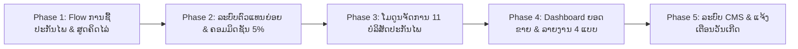

# ແຜນປັບປຸງລະບົບ SAIYFON INSURANCE DIGITAL (Client Web App)
> **ເອກະສານ:** ແຜນປະຕິບັດງານການປັບປຸງ Client ໃຫ້ສອດຄ່ອງກັບຄວາມຕ້ອງການຫຼັກຂອງທຸລະກິດ ນາຍໜ້າປະກັນໄພ (Broker)  
> **ອີງຕາມ:** [SAIYFON_BACKOFFICE_AND_APP_PLAN_SPEC.md](file:///Users/macpro/Developer/NuxtJS/SAIYFON_INSURANCE_DIGITAL/SAIYFON_BACKOFFICE_AND_APP_PLAN_SPEC.md) ແລະ ເອກະສານ PDF ຕົ້ນສະບັບ  
> **ວັນທີສ້າງ:** 2026-10-27  
> **ສະຖານະ:** ພ້ອມດຳເນີນການ (Ready for Implementation)

---

## 🎯 1. ເປົ້າໝາຍ ແລະ ຫຼັກການປັບປຸງ (Goals & Principles)

1. **ປ່ຽນຜ່ານຈາກ Multi-Tenant SaaS ທົ່ວໄປ ມາເປັນ "Saiyfon Broker Digital Hub":**  
   ສ້າງ Web App ທີ່ສະແດງເອກະລັກຂອງ "ສາຍຝົນ ນາຍໜ້າປະກັນໄພ" ຢ່າງຊັດເຈນ ເປັນສູນກາງເຊື່ອມຕໍ່ລະຫວ່າງ 11+ ບໍລິສັດປະກັນໄພຊັ້ນນຳ, ຕົວແທນຂາຍຍ່ອຍ (Sub-Agents) ແລະ ລູກຄ້າທົ່ວໄປ.
2. **ເປີດໂອກາດໃຫ້ທຸກຄົນເປັນຕົວແທນຂາຍຍ່ອຍໄດ້ (Sub-Agent Empowerment):**  
   ສ້າງລະບົບສະໝັກຕົວແທນອອນລາຍ (Self-Service Agent Registration), ໄດ້ຮັບຄອມມິດຊັນ **5% ອັດຕະໂນມັດທັນທີ**, ມີລະບົບສະສົມ Point ແລະ ລະບົບໂອນເງິນຄືນ (Cashback).
3. **ປັບປຸງ Flow ການຊື້ປະກັນໄພໃຫ້ຖືກຕ້ອງຕາມ Business Logic 100%:**  
   ມີ Modal ເລືອກ "ລົດຮັບຈ້າງ / ສ່ວນຕົວ", ສູດຄິດໄລ່ເບ້ຍປະກັນ (VAT 7% + ຄ່າທະບຽນ 20,000 ກີບ) ແລະ ການຊຳລະເງິນຜ່ານ **BCEL One (OnePay QR)**.
4. **ລະບົບຈັດການຂໍ້ມູນຫຼັກ (Master Data) & ລາຍງານຍອດຂາຍຫຼັງບ້ານ:**  
   ຈັດການບໍລິສັດປະກັນໄພ 11 ແຫ່ງ, ອັດຕາຄອມມິດຊັນ, ລາຍງານຍອດຂາຍ 4 ຮູບແບບ ແລະ ລະບົບແຈ້ງເຕືອນວັນເກີດ.

---

## 🗺️ 2. ໄລຍະການດຳເນີນງານ (Implementation Phases)

---

## 📋 3. ລາຍລະອຽດແຕ່ລະ Phase

### 🚀 Phase 1: ປັບປຸງ Flow ການເລືອກຊື້ປະກັນໄພລົດ & ສູດຄິດໄລ່ເງິນ
**ຈຸດປະສົງ:** ໃຫ້ລູກຄ້າ ແລະ ຕົວແທນສາມາດເລືອກຊື້ປະກັນໄພໄດ້ຢ່າງຖືກຕ້ອງ, ໂປ່ງໃສ ແລະ ຊຳລະເງິນຜ່ານ BCEL One ໄດ້ຕົວຈິງ.

| ລ/ດ | ໜ້າວຽກ (Tasks) | ໄຟລ໌ທີ່ກ່ຽວຂ້ອງ | ລາຍລະອຽດການດຳເນີນງານ |
|---|---|---|---|
| 1.1 | **ເລືອກປະເພດລົດ 6 ໝວດ** | `PolicyWizard.vue`, `constants.js` | ປັບຕົວເລືອກປະເພດລົດໃຫ້ມີ: ລົດເກັງ, ລົດກະບະ, ລົດຈິບ, ລົດຕູ້, ລົດບັນທຸກ, ລົດເມ ພ້ອມໄອຄອນ. |
| 1.2 | **Modal Popup "ລົດຮັບຈ້າງ ຫຼື ສ່ວນຕົວ"** | `VehicleUsageModal.vue` (ສ້າງໃໝ່) | ເມື່ອກົດເລືອກປະເພດລົດ ໃຫ້ເດັ້ງ Modal ຂຶ້ນມາທັນທີ ເພື່ອບັງຄັບເລືອກລະຫວ່າງ:  • **ລົດສ່ວນຕົວ (Personal Use)** • **ລົດຮັບຈ້າງ (Commercial/Hire Use)** *(ເພາະລາຄາເບ້ຍປະກັນແຕກຕ່າງກັນ)* |
| 1.3 | **ປັບປຸງສູດຄິດໄລ່ເງິນ (Premium Formula)** | `utils/premium.js`, `PolicyWizard.vue` | ປັບສູດການຄຳນວນເບ້ຍປະກັນໃຫ້ກົງກັບ SPEC: 1. ເບ້ຍຫຼັງຫຼຸດ = ເບ້ຍພື້ນຖານ - ສ່ວນຫຼຸດ (Discount) 2. VAT 7% = ເບ້ຍຫຼັງຫຼຸດ × 0.07 3. ຄ່າຂຶ້ນທະບຽນສັນຍາ = `20,000 ກີບ` 4. **ຍອດລວມສຸດທິ = ເບ້ຍຫຼັງຫຼຸດ + VAT + 20,000 ກີບ** |
| 1.4 | **ໜ້າຊຳລະເງິນ BCEL OnePay QR** | `PolicyPaymentStep.vue`, `PolicyWizard.vue` | ສະແດງ QR Code ມາດຕະຖານ OnePay (BCEL One) ພ້ອມປຸ່ມ "ກົດຊຳລະຄ່າປະກັນໄພ" ແລະ ເວລານັບຖອຍຫຼັງ. |
| 1.5 | **ອອກໃບຢັ້ງຢືນ Digital Certificate** | `PolicySuccessStep.vue` | ສະແດງໃບຢັ້ງຢືນສັນຍາ (WEC-XXXXXX) ພ້ອມ QR Code ກວດສອບສັນຍາ, ຂໍ້ມູນລົດ, ຂໍ້ມູນຜູ້ເອົາປະກັນ. |

---

### 👥 Phase 2: ລະບົບລົງທະບຽນຕົວແທນຂາຍຍ່ອຍ & ຄອມມິດຊັນ 5% (Sub-Agent Portal)
**ຈຸດປະສົງ:** ເປີດໂອກາດໃຫ້ຜູ້ໃຊ້ທົ່ວໄປສະໝັກເປັນຕົວແທນຂາຍຍ່ອຍ (Sub-Agent) ໄດ້ງ່າຍ, ຮັບຄອມມິດຊັນ 5% ໂອໂຕ ແລະ ສະສົມແຕ້ມ.

| ລ/ດ | ໜ້າວຽກ (Tasks) | ໄຟລ໌ທີ່ກ່ຽວຂ້ອງ | ລາຍລະອຽດການດຳເນີນງານ |
|---|---|---|---|
| 2.1 | **ໜ້າສະໝັກຕົວແທນອອນລາຍ (Self-Register)** | `pages/agents/register.vue` (ສ້າງໃໝ່) | ສ້າງຟອມສະໝັກຕົວແທນໜ້າເວັບ: ຊື່, ນາມສະກຸນ, ເບີໂທ, ທີ່ຢູ່, ອັບໂຫລດບັດປະຈຳຕົວ/Passport, ບັນຊີ BCEL ເພື່ອຮັບເງິນຄອມ. |
| 2.2 | **ກົດເກນໂອໂຕຄອມມິດຊັນ 5%** | `stores/auth.js`, `server/api/agents` | ເມື່ອລົງທະບຽນສຳເລັດ ລະບົບຈະກຳນົດ `commission_rate = 5%` ໃຫ້ອັດຕະໂນມັດທັນທີ ໂດຍບໍ່ຕ້ອງລໍຖ້າ Admin ອະນຸມັດ. |
| 2.3 | **ລະບົບສະສົມຄະແນນ (Points System)** | `utils/points.js`, `pages/agents/profile.vue` | ບັນທຶກ ແລະ ສະແດງແຕ້ມສະສົມ: **1 ສັນຍາ = 5,000 Point (ມູນຄ່າ 3,000 ກີບ)** ພ້ອມລະບົບແລກຂອງລາງວັນ/ເງິນສົດ. |
| 2.4 | **ແຈ້ງເຕືອນ Cashback 5% (BCEL Re-Transfer)** | `components/feature/CashbackAlertModal.vue` | ສະແດງປັອບອັບແຈ້ງເຕືອນເມື່ອຂາຍສຳເລັດ: *"ຂໍສະແດງຄວາມຍິນດີ You get commission 5% - ຮັບເງິນຈາກການຂາຍປະກັນໄພ: xx,xxx ກີບ"*. |
| 2.5 | **Agent Dashboard ໜ້າຕິດຕາມຜົນງານ** | `pages/home.vue` (ສຳລັບ Role Agent) | ສະແດງຍອດຂາຍຂອງຕົນເອງ, ຈຳນວນສັນຍາທີ່ຂາຍໄດ້, ຄອມມິດຊັນສະສົມ, ແລະ ປຸ່ມທາງລັດ "ອອກປະກັນໄພໃໝ່". |

---

### 🏢 Phase 3: ໂມດູນຈັດການ 11 ບໍລິສັດປະກັນໄພ & ອັດຕາຄອມມິດຊັນ (Insurance Co. Master)
**ຈຸດປະສົງ:** ໃຫ້ແອດມິນສາມາດຈັດການຂໍ້ມູນບໍລິສັດປະກັນໄພຄູ່ຮ່ວມ ແລະ ກຳນົດອັດຕາຄອມມິດຊັນແຍກຕາມແຕ່ລະບໍລິສັດ/ຜະລິດຕະພັນ.

| ລ/ດ | ໜ້າວຽກ (Tasks) | ໄຟລ໌ທີ່ກ່ຽວຂ້ອງ | ລາຍລະອຽດການດຳເນີນງານ |
|---|---|---|---|
| 3.1 | **ເພີ່ມເມນູ "ບໍລິສັດປະກັນໄພ" ໃນ Sidebar** | `config/navigation.js` | ເພີ່ມເມນູ **"ບໍລິສັດປະກັນໄພ" (Insurance Companies)** ແລະ **"ຜະລິດຕະພັນ & ຄອມມິດຊັນ"** ພາຍໃຕ້ໝວດ Master Data. |
| 3.2 | **ໜ້າຈັດການບໍລິສັດປະກັນໄພ (CRUD)** | `pages/insurers/index.vue`, `[id].vue` | ຈັດການລາຍຊື່ 11 ບໍລິສັດ (Dhipaya, APA, Soksay, LVI, Allianz, Forte-Toko...): ລະຫັດ, ຊື່ເຕັມ, ຊື່ຫຍໍ້, ໂລໂກ້, ເບີໂທ, ທີ່ຢູ່, ຜູ້ຕິດຕໍ່. |
| 3.3 | **ໜ້າກຳນົດອັດຕາຄອມມິດຊັນແຕ່ລະບໍລິສັດ** | `pages/insurers/commissions.vue` | ຕາຕະລາງກຳນົດອັດຕາຄອມມິດຊັນທີ່ Broker ໄດ້ຮັບຈາກແຕ່ລະບໍລິສັດ ແລະ ແຕ່ລະປະເພດປະກັນໄພ (e.g. Dhipaya Motor = 25%, Fire = 23%). |
| 3.4 | **ຈັດການຂໍ້ມູນລົດ (Vehicle Master)** | `pages/customers/vehicles.vue` | ລະບົບຄົ້ນຫາ ແລະ ຈັດການຂໍ້ມູນລົດທີ່ລົງທະບຽນ (ເລກຈັກ, ເລກຖັງ, ປ້າຍທະບຽນ, ຮູບລົດ, VIP Card). |

---

### 📈 Phase 4: ປັບປຸງ Dashboard & ລາຍງານຍອດຂາຍ 4 ແບບ (Underwriting Reports)
**ຈຸດປະສົງ:** ປັບໜ້າ Dashboard ໃຫ້ສະແດງຜົນງານການຂາຍປຽບທຽບແຕ່ລະບໍລິສັດປະກັນໄພ ແລະ ອອກລາຍງານໄດ້ຄົບ 4 ຮູບແບບ.

| ລ/ດ | ໜ້າວຽກ (Tasks) | ໄຟລ໌ທີ່ກ່ຽວຂ້ອງ | ລາຍລະອຽດການດຳເນີນງານ |
|---|---|---|---|
| 4.1 | **Dashboard YTD Sales by Insurer** | `pages/dashboard/index.vue` | • ເພີ່ມບັດ KPI: Target (3.6 ຕື້), ຍອດປີ 2021, ຍອດປີ 2022, ສ່ວນຕ່າງ Variance. • ເພີ່ມກຣາຟ ແລະ ຕາຕະລາງຍອດຂາຍສະສົມຕາມ 11 ບໍລິສັດປະກັນໄພ. |
| 4.2 | **ລາຍງານ 4 ຮູບແບບຕາມ PDF** | `pages/reports/underwriting.vue` | 1. **By Date Range:** ລາຍງານຍອດຂາຍທັງໝົດ 2. **By Company & Date Range:** ລາຍງານຍອດຂາຍແຍກຕາມບໍລິສັດ 3. **Policy Expiration:** ລາຍງານສັນຍາໃກ້ໝົດອາຍຸທັງໝົດ 4. **Policy Expiration by Agent:** ລາຍງານສັນຍາໃກ້ໝົດອາຍຸສະເພາະຕົວແທນ |
| 4.3 | **ລະບົບ Export ລາຍງານຫຼາຍຮູບແບບ** | `composables/useExport.js` | ຮອງຮັບການດາວໂຫຼດລາຍງານເປັນ **Excel (.xlsx)**, **PDF**, **CSV**. |

---

### 🎁 Phase 5: ລະບົບການຕະຫຼາດ (Marketing CMS) & ແຈ້ງເຕືອນວັນເກີດ
**ຈຸດປະສົງ:** ເຄື່ອງມືໃຫ້ທີມການຕະຫຼາດສ້າງກິດຈະກຳກະຕຸ້ນຍອດຂາຍເທິງແອັບ ແລະ ດູແລລູກຄ້າ.

| ລ/ດ | ໜ້າວຽກ (Tasks) | ໄຟລ໌ທີ່ກ່ຽວຂ້ອງ | ລາຍລະອຽດການດຳເນີນງານ |
|---|---|---|---|
| 5.1 | **ລະບົບແຈ້ງເຕືອນວັນເກີດ (Birthday Alerts)** | `components/shell/NotificationMenu.vue`, Dashboard | ແຈ້ງເຕືອນອັດຕະໂນມັດ: **ວັນເດືອນປີເກີດ User/Agent** ແລະ **ວັນເດືອນປີເກີດລູກຄ້າ** ເພື່ອສົ່ງຄຳອວຍພອນ ແລະ ໂປຣໂມຊັ່ນ. |
| 5.2 | **Popup Banner ໂຄສະນາເທິງແອັບ** | `pages/marketing/banners.vue` | ລະບົບສ້າງ ແລະ ຈັດການປັອບອັບໂຄສະນາ ເພື່ອສະແດງເມື່ອຜູ້ໃຊ້ເປີດແອັບ. |
| 5.3 | **Sync ສັນຍາກັບແອັບ ("ປະກັນໄພຂອງຂ້ອຍ")** | `pages/policies/my-policies.vue` | ທຸກສັນຍາທີ່ອອກແລ້ວ (APA, Soksay, Dhipaya, Champa...) ຈະຖືກ Sync ໄປສະແດງໃນແຖບ *"ປະກັນໄພຂອງຂ້ອຍ"* ເພື່ອກວດຄືນໄດ້ທັນທີ. |

---

## ⏱️ 4. ລຳດັບຄວາມສຳຄັນ ແລະ ກຳນົດເວລາ (Sprint Roadmap)

| Sprint | ເນື້ອໃນຫຼັກ (Milestones) | ໄລຍະເວລາປະມານການ | ຜົນໄດ້ຮັບ (Deliverables) |
|---|---|---|---|
| **Sprint 1** | **Phase 1: Flow ຊື້ປະກັນໄພລົດ, Modal ຮັບຈ້າງ/ສ່ວນຕົວ, ສູດ VAT 7% & OnePay QR** | 2 - 3 ວັນ | ລູກຄ້າ ແລະ ຕົວແທນສາມາດກົດຊື້ປະກັນໄພລົດ, ເລືອກປະເພດລົດ, ຄຳນວນເງິນຖືກຕ້ອງ ແລະ ເຫັນ QR ຊຳລະເງິນ. |
| **Sprint 2** | **Phase 2: ໜ້າສະໝັກຕົວແທນຍ່ອຍ (Self-Register), ຄອມມິດຊັນ 5% & Point** | 2 ວັນ | ຜູ້ໃຊ້ທົ່ວໄປສາມາດກົດສະໝັກຕົວແທນ, ໄດ້ລະຫັດຕົວແທນ, ໄດ້ຄອມ 5% ແລະ ເຫັນ Dashboard ຂອງຕົນເອງ. |
| **Sprint 3** | **Phase 3: ໂມດູນຈັດການ 11 ບໍລິສັດປະກັນໄພ & ອັດຕາຄອມມິດຊັນ** | 2 ວັນ | ແອດມິນສາມາດເພີ່ມ/ແກ້ໄຂບໍລິສັດປະກັນໄພ ແລະ ຕັ້ງຄ່າ % ຄອມມິດຊັນຂອງແຕ່ລະບໍລິສັດ. |
| **Sprint 4** | **Phase 4 & 5: Dashboard ປຽບທຽບຍອດຂາຍ, ລາຍງານ 4 ແບບ & ແຈ້ງເຕືອນວັນເກີດ** | 2 - 3 ວັນ | Dashboard ສົມບູນແບບຕາມ PDF ໜ້າ 3, ອອກລາຍງານໄດ້ 4 ແບບ, ແລະ ມີແຈ້ງເຕືອນວັນເກີດ. |

---

## ✅ 5. ມາດຕະຖານການກວດສອບຄຸນນະພາບ (Acceptance Criteria)

- [ ] **Modal ລົດຮັບຈ້າງ / ສ່ວນຕົວ:** ຕ້ອງສະແດງທຸກຄັ້ງທີ່ເລືອກປະເພດລົດ 6 ໝວດໝູ່.
- [ ] **ສູດເງິນ:** Total = (Base - Discount) + VAT 7% + 20,000 Kip (ກວດສອບເລກເສດຖືກຕ້ອງ 100%).
- [ ] **OnePay QR:** ມີໜ້າສະແດງ QR Code ສຳລັບການຊຳລະເງິນ.
- [ ] **Agent 5% Commission:** ສະໝັກຕົວແທນແລ້ວ ຕ້ອງໄດ້ຄອມມິດຊັນ 5% ທັນທີໂດຍບໍ່ຕ້ອງລໍຖ້າ Admin ອະນຸມັດດ້ວຍມື.
- [ ] **Cashback & Points:** ມີປັອບອັບແຈ້ງເຕືອນ 5% Cashback ແລະ ແຕ້ມສະສົມ 5,000 Point = 3,000 Kip.
- [ ] **Master Data 11 ບໍລິສັດ:** ມີຂໍ້ມູນ ແລະ ໂລໂກ້ຂອງ 11 ບໍລິສັດຄົບຖ້ວນ.
- [ ] **Reports:** ສາມາດກອງຂໍ້ມູນ ແລະ Export ລາຍງານທັງ 4 ຮູບແບບໄດ້.
